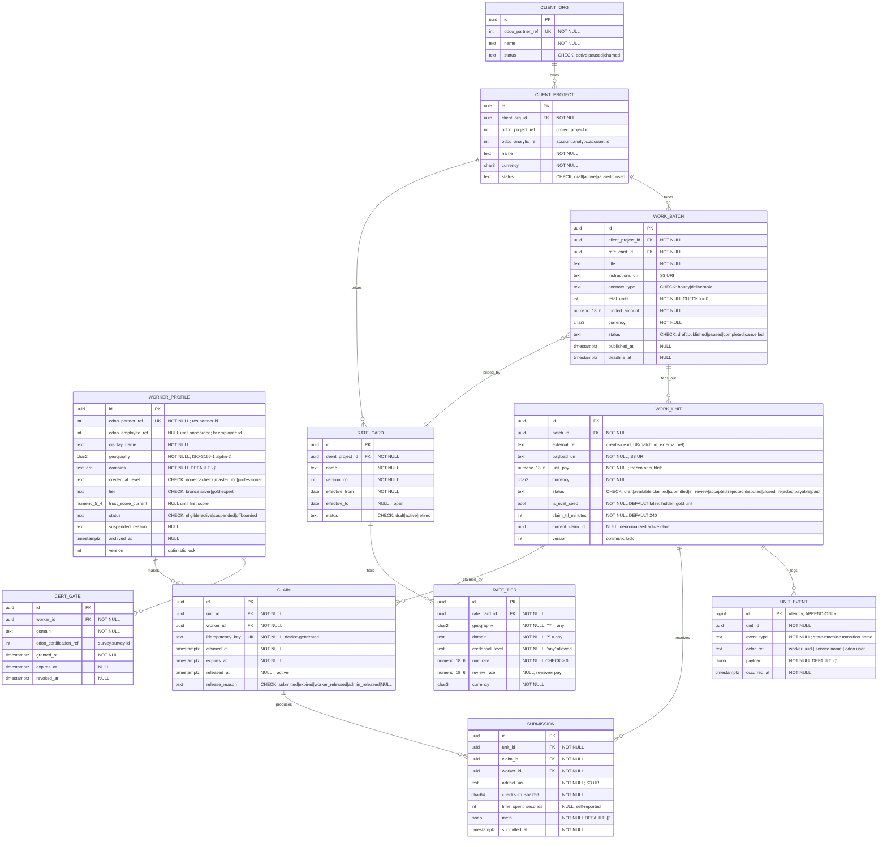
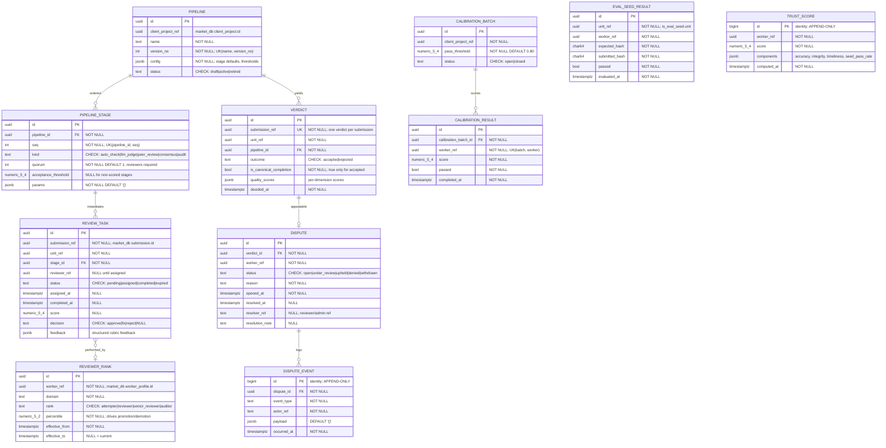
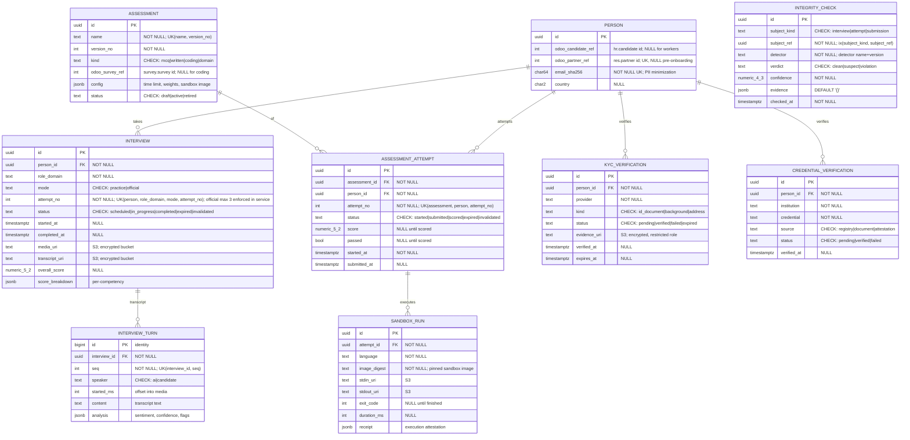
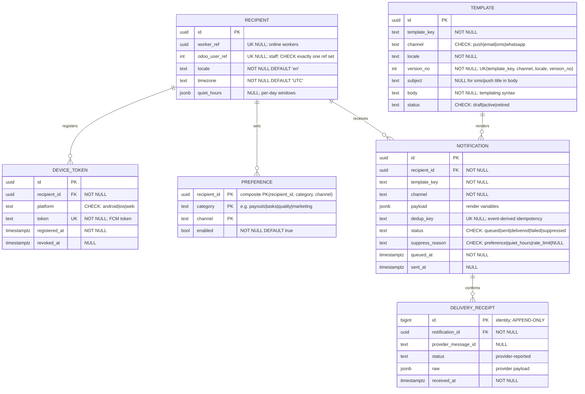
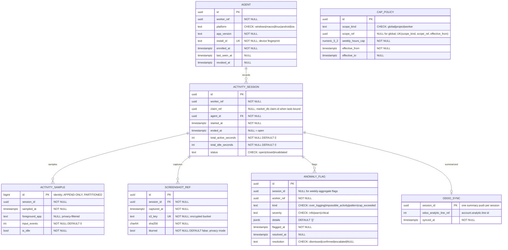
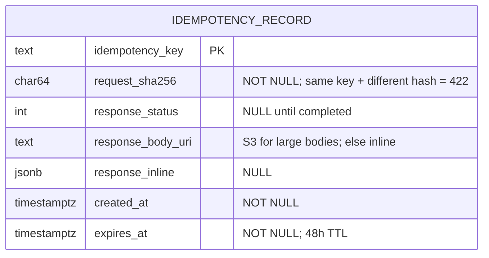

# Scope and Conventions

This document is the authoritative physical data model. The condensed ERDs in [DESIGN.md](DESIGN.md) are orientation; this is implementation. Each numbered store below is a physically separate PostgreSQL database owned by exactly one service (database-per-service, per [ARCHITECTURE.md](ARCHITECTURE.md)). Odoo's own tables are generated by its ORM and are not hand-implemented; section 9 specifies the in-house `ethara_*` Odoo models at the field level instead.

Conventions applied to every service store unless a table states otherwise:

| Convention | Rule |
|---|---|
| Primary keys | `id uuid` (UUIDv7), `DEFAULT`, never exposed as sequence-guessable |
| Timestamps | `timestamptz`; every table carries `created_at timestamptz NOT NULL DEFAULT now()` and `updated_at timestamptz NOT NULL DEFAULT now()` (trigger-maintained); these two are omitted from the diagrams for brevity but are mandatory |
| Money | `numeric(18,6)` amounts + `currency char(3)` ISO-4217; never float |
| Enumerations | `text` + named `CHECK` constraint (values listed per table); no native `ENUM` types (migration cost) |
| Cross-store references | `*_ref` columns are logical references (uuid or Odoo integer id) with **no** cross-database FK; consistency is eventual via events; `odoo_*_ref` columns are Odoo integer ids |
| Soft delete | `archived_at timestamptz NULL` where a row may be retired but must remain referencable |
| Append-only tables | Marked APPEND-ONLY: no UPDATE or DELETE grants to the service role; corrections are compensating rows |
| High-volume tables | Marked PARTITIONED: PostgreSQL declarative range partitioning by month on the stated column; retention as stated |
| Optimistic locking | `version int NOT NULL DEFAULT 0` on tables mutated concurrently through APIs |

# 1. market_db (services/market)

**Constraints and indexes (market_db).**

| Object | Definition |
|---|---|
| `claim` active-exclusivity | `CREATE UNIQUE INDEX uq_claim_active ON claim(unit_id) WHERE released_at IS NULL;` - the database-level guarantee that one unit has at most one live claim; the claim transaction is `SELECT ... FROM work_unit WHERE id = $1 AND status = 'available' FOR UPDATE SKIP LOCKED` then insert claim + update status, single transaction |
| `claim` idempotency | `UNIQUE (idempotency_key)` - a retried claim returns the original row, never a second claim |
| `work_unit` browse path | `CREATE INDEX ix_unit_available ON work_unit(batch_id, status) WHERE status = 'available';` plus `ix_unit_status (status, updated_at)` |
| `work_unit` external identity | `UNIQUE (batch_id, external_ref)` |
| `rate_tier` resolution | `UNIQUE (rate_card_id, geography, domain, credential_level)`; resolution order in service code: exact > domain-wildcard > geography-wildcard |
| `cert_gate` identity | `UNIQUE (worker_id, domain, odoo_certification_ref)` |
| Partitioning | `work_unit`, `claim`, `submission`, `unit_event`: monthly range partitions on `created_at`/`occurred_at`; retention: unit/claim/submission 24 months then archive to S3 parquet; `unit_event` 12 months |
| FK policy | All intra-store FKs `ON DELETE RESTRICT`; nothing cascades in a money-bearing store |

# 2. quality_db (services/quality)

**Constraints and indexes (quality_db).** `verdict.submission_ref` UNIQUE is the exactly-once guarantee behind the canonical completion signal; the outbox publisher reads `verdict` rows with a `published_at timestamptz NULL` column (add it) and marks them after emit, giving at-least-once emit with consumer-side dedup on `verdict.id`. `review_task`: `ix (reviewer_ref, status)`, `ix (submission_ref)`, partial `ix (status) WHERE status = 'pending'` for the dispatcher. `reviewer_rank`: `UNIQUE (worker_ref, domain) WHERE effective_to IS NULL` (one current rank per domain). `trust_score`: `ix (worker_ref, computed_at DESC)`. Partitioned monthly: `review_task`, `eval_seed_result`, `trust_score`, `dispute_event` (retention 24 months). Eval-seed expected hashes never leave this store (Firewall: workers must not distinguish seeds).

# 3. assess_db (services/assess)

**Constraints and indexes (assess_db).** PII posture: raw email/phone never stored (hash only); media, transcripts, and KYC evidence live in an encrypted S3 bucket with a dedicated IAM role; `kyc_verification.evidence_uri` readable only by the KYC subrole. `interview_turn` partitioned monthly, retention 12 months post-decision, then transcripts summarized and raw turns purged. `integrity_check` is APPEND-ONLY.

# 4. payout_db (services/payout)

```mermaid
erDiagram
    PAYEE ||--o{ RAIL_ACCOUNT : owns
    PAYEE ||--o{ EARNING : accrues
    COMPLETION_EVENT ||--o| EARNING : births
    PAYOUT_BATCH ||--o{ PAYOUT_TXN : contains
    PAYOUT_TXN }o--|| RAIL_ACCOUNT : via
    PAYOUT_TXN ||--o{ PAYOUT_TXN_EARNING : settles
    EARNING ||--o{ PAYOUT_TXN_EARNING : settled_by
    PAYEE ||--o{ REFERRAL_EDGE : refers
    REFERRAL_EDGE ||--o{ REFERRAL_ACCRUAL : accrues
    EARNING ||--o| REFERRAL_ACCRUAL : sourced_from
    PAYOUT_TXN ||--o| LEDGER_LINK : reconciles
    PAYEE ||--o{ INSTANT_PAYOUT_REQUEST : requests

    PAYEE {
        uuid id PK
        uuid worker_ref UK "NOT NULL; market_db worker_profile.id"
        int odoo_partner_ref UK "NOT NULL; vendor res.partner id"
        char2 country "NOT NULL"
        text tax_status "CHECK: pan_verified|w9_on_file|w8ben_on_file|pending"
        date first_payout_hold_until "NULL; 7-day hold policy"
        text status "CHECK: active|blocked|closed"
        int version "optimistic lock"
    }
    RAIL_ACCOUNT {
        uuid id PK
        uuid payee_id FK "NOT NULL"
        text rail "CHECK: stripe_connect|wise|razorpay"
        text external_account_id "NOT NULL; UK(payee_id, rail, external_account_id)"
        char3 currency "NOT NULL; payout currency"
        text status "CHECK: pending|active|blocked"
        bool is_default "NOT NULL DEFAULT false"
        timestamptz verified_at "NULL"
    }
    COMPLETION_EVENT {
        uuid id PK "= quality verdict.id; idempotent ingest"
        uuid unit_ref "NOT NULL"
        uuid worker_ref "NOT NULL"
        uuid batch_ref "NOT NULL"
        numeric_18_6 gross_amount "NOT NULL; from rate card at claim"
        char3 currency "NOT NULL"
        timestamptz occurred_at "NOT NULL; verdict decided_at"
        timestamptz ingested_at "NOT NULL"
    }
    EARNING {
        uuid id PK
        uuid payee_id FK "NOT NULL"
        uuid completion_event_id FK "UK; NULL for referral/bonus/adjustment kinds"
        text kind "CHECK: unit|hourly|referral|bonus|adjustment"
        numeric_18_6 gross "NOT NULL"
        numeric_18_6 tds_estimate "NOT NULL DEFAULT 0"
        char3 currency "NOT NULL"
        text status "CHECK: accrued|held|scheduled|billed|paid|reversed"
        text hold_reason "CHECK: first_payout|dispute|integrity|manual|NULL"
        timestamptz accrued_at "NOT NULL"
    }
    PAYOUT_BATCH {
        uuid id PK
        date pay_window_start "NOT NULL"
        date pay_window_end "NOT NULL; UK(pay_window_start, pay_window_end)"
        date scheduled_for "NOT NULL; weekly cadence"
        text status "CHECK: open|processing|settled|partially_failed|closed"
        jsonb totals "per-currency gross/tds/fees/net"
    }
    PAYOUT_TXN {
        uuid id PK
        uuid batch_id FK "NULL for instant payouts"
        uuid payee_id FK "NOT NULL"
        uuid rail_account_id FK "NOT NULL"
        numeric_18_6 gross "NOT NULL"
        numeric_18_6 tds_withheld "NOT NULL"
        numeric_18_6 fees "NOT NULL DEFAULT 0"
        numeric_18_6 net "NOT NULL; CHECK net = gross - tds_withheld - fees"
        char3 currency "NOT NULL"
        text rail_txn_id "UK NULL until submitted"
        text status "CHECK: pending|submitted|settled|failed|returned"
        timestamptz submitted_at "NULL"
        timestamptz settled_at "NULL"
        text failure_code "NULL"
    }
    PAYOUT_TXN_EARNING {
        uuid txn_id PK "composite PK(txn_id, earning_id)"
        uuid earning_id PK
        numeric_18_6 amount "NOT NULL; partial settle support"
    }
    REFERRAL_EDGE {
        uuid id PK
        uuid referrer_payee_id FK "NOT NULL"
        uuid referee_worker_ref UK "NOT NULL; one referrer per referee"
        numeric_5_2 share_pct "NOT NULL CHECK 0-100"
        numeric_18_6 cap_amount "NOT NULL"
        char3 cap_currency "NOT NULL"
        bool id_verified "NOT NULL DEFAULT false; gates payout"
        bool active "NOT NULL DEFAULT true"
    }
    REFERRAL_ACCRUAL {
        uuid id PK
        uuid edge_id FK "NOT NULL"
        uuid source_earning_id FK "UK NOT NULL; one accrual per source earning"
        numeric_18_6 amount "NOT NULL"
        text status "CHECK: accrued|capped|paid|reversed"
        timestamptz accrued_at "NOT NULL"
    }
    LEDGER_LINK {
        uuid id PK
        text subject_kind "CHECK: earning|payout_txn"
        uuid subject_id "NOT NULL; UK(subject_kind, subject_id)"
        int odoo_vendor_bill_ref "account.move id; NULL until billed"
        int odoo_payment_ref "account.payment id; NULL until paid"
        bool reconciled "NOT NULL DEFAULT false"
        timestamptz reconciled_at "NULL"
    }
    INSTANT_PAYOUT_REQUEST {
        uuid id PK
        uuid payee_id FK "NOT NULL"
        numeric_18_6 amount "NOT NULL"
        numeric_18_6 fee "NOT NULL; percent policy"
        uuid payout_txn_id "NULL until executed"
        text status "CHECK: requested|approved|executed|rejected"
        timestamptz requested_at "NOT NULL"
    }
```

**Constraints and indexes (payout_db).** Exactly-once money: `completion_event.id` reuses the quality `verdict.id`, so replayed events collide on PK and are no-ops; `earning.completion_event_id` UNIQUE prevents double accrual; `referral_accrual.source_earning_id` UNIQUE prevents double share. Cap enforcement: a `BEFORE INSERT` trigger on `referral_accrual` sums prior non-reversed accruals for the edge and clamps/marks `capped` (plus service-level check). Reconciliation invariant (rails equal ledger net of TDS) is a nightly job comparing `SUM(payout_txn.net) WHERE settled` against Odoo payment totals via `ledger_link`; mismatches raise alerts, never auto-adjust. Indexes: `earning (payee_id, status)`, `payout_txn (batch_id)`, `payout_txn (status) WHERE status IN ('pending','submitted')`, `ledger_link (reconciled) WHERE NOT reconciled`. `earning`, `payout_txn`, `completion_event` partitioned monthly, retention 8 years (statutory finance).

# 5. notify_db (services/notify)

**Constraints and indexes (notify_db).** `notification.dedup_key` UNIQUE gives one send per domain event per recipient per channel. `notification` partitioned monthly, retention 6 months; `delivery_receipt` 3 months. Index: `notification (recipient_id, queued_at DESC)`, partial `(status) WHERE status = 'queued'` for the dispatcher.

# 6. tracker_db (services/tracker)

**Constraints and indexes (tracker_db).** `activity_sample` is the highest-volume table in the platform (200K agents at shift boundaries): monthly partitions, `ix (session_id, sampled_at)`, retention 90 days raw then aggregated; `screenshot_ref` retention 180 days (policy-visible to workers), encrypted bucket, worker-visible access log. Cap enforcement queries roll up `activity_session` per ISO week against the most specific `cap_policy` (worker > project > global).

# 7. gateway_db (services/gateway) and Redis keyspaces

Redis (primary, PG table above is the durable fallback written asynchronously): `idem:{key}` (SETNX + TTL 48h), `rl:{worker}:{route}` sliding-window rate-limit counters (TTL window), `sess:odoo:{sid}` Odoo sessions (owned by `ethara_session_redis`, separate logical DB). A partitioned nightly job purges expired `idempotency_record` rows.

# 8. analytics_db (services/analytics)

Derived and rebuildable by contract: every table here can be dropped and rebuilt from Debezium CDC topics plus the event-bus archive, so no table is a system of record and schema evolves freely. Baseline marts: `dim_worker`, `dim_project`, `dim_date`, `fact_unit_lifecycle` (one row per unit state transition), `fact_payout` (grain: payout_txn), `fact_quality` (grain: verdict), `fact_attendance` (grain: check-in), `event_archive` (raw CloudEvents, partitioned daily, Parquet offload after 30 days). A junior DBA implements only `event_archive` and the CDC landing schemas; marts are dbt-style transformations defined in the service repo.

# 9. Odoo `ethara_*` models (ORM field specifications)

Odoo generates these tables from model definitions; the DBA-relevant contract is the field spec. Types are Odoo field types (`Char` = varchar, `Selection` = varchar + app-level check, `Many2one` = integer FK with ondelete policy).

| Model (table) | Fields |
|---|---|
| `ethara.site` (`ethara_site`) | `name Char required`; `latitude Float(digits=(10,7)) required`; `longitude Float(digits=(10,7)) required`; `radius_m Integer required default 200`; `company_id Many2one res.company` |
| `hr.attendance` (extension) | `site_id Many2one ethara.site ondelete=restrict`; `geofence_ok Boolean compute stored`; `exception_state Selection [none, flagged, approved, rejected] default none`; `exception_approver_id Many2one res.users` |
| `ethara.onboarding` (`ethara_onboarding`) | `employee_id Many2one hr.employee required ondelete=restrict`; `partner_id Many2one res.partner required (vendor pair)`; `state Selection [draft, kyc, contract, tax, payment, complete] default draft`; `kyc_verified Boolean`; `kyc_ref Char (assess_db kyc uuid)`; `sign_request_id Many2one sign.oca.request`; `tax_form Selection [pan, w9, w8ben]`; `tax_attachment_id Many2one ir.attachment`; `payout_ready Boolean`; `completed_at Datetime`; SQL constraint: `unique(employee_id)` |
| `itms.problem` (`itms_problem`) | `name Char required`; `ticket_ids Many2many helpdesk.ticket`; `equipment_ids Many2many maintenance.equipment`; `root_cause Text`; `state Selection [open, analyzing, known_error, resolved, closed]`; `owner_id Many2one res.users` |
| `itms.change.request` (`itms_change_request`) | `name Char required`; `kind Selection [standard, normal, emergency]`; `risk Selection [low, medium, high]`; `state Selection [draft, submitted, approved, implementing, done, rolled_back]` (tier-validation reviewed); `planned_start/planned_end Datetime`; `rollback_plan Text required`; `ci_ids Many2many maintenance.equipment` |
| `itms.assignment.history` (`itms_assignment_history`) | `equipment_id Many2one maintenance.equipment required ondelete=restrict`; `employee_id Many2one hr.employee required`; `assigned_at Datetime required`; `returned_at Datetime`; `condition_note Text`; append-only by convention (no unlink ACL) |
| `itms.software.license` (`itms_software_license`) | `name Char required`; `vendor_id Many2one res.partner`; `contract_id Many2one contract.contract`; `seats_total Integer required`; `seats_used Integer compute stored`; `renewal_date Date`; `analytic_account_id Many2one account.analytic.account`; `state Selection [active, expiring, expired, cancelled]` |
| `itms.license.seat` (`itms_license_seat`) | `license_id Many2one itms.software.license required ondelete=cascade`; `employee_id Many2one hr.employee required`; `assigned_at Datetime`; `revoked_at Datetime`; SQL constraint: one active seat per (license, employee) |
| `ethara.shift` (`ethara_shift`) | `role_id Many2one hr.job`; `employee_id Many2one hr.employee (NULL = open shift)`; `site_id Many2one ethara.site`; `start_dt/end_dt Datetime required`; `state Selection [draft, open, claimed, confirmed, done, cancelled]`; `claim_portal_token Char (portal self-claim)` |
| `ethara.tracker.summary` (`ethara_tracker_summary`) | `analytic_line_id Many2one account.analytic.line ondelete=cascade`; `session_ref Char required (tracker_db session uuid)`; `active_seconds Integer`; `idle_seconds Integer`; `anomaly_count Integer`; SQL constraint: `unique(session_ref)` |

# 10. Cross-Store Reference Map

| Column (store) | Points to | Consistency |
|---|---|---|
| `worker_profile.odoo_partner_ref`, `payee.odoo_partner_ref` (market, payout) | Odoo `res_partner.id` | Created by `ethara_onboarding` completion event; immutable thereafter |
| `worker_ref` (quality, payout, notify, tracker) | `market_db.worker_profile.id` | Broadcast on `worker.lifecycle` events |
| `completion_event.id` (payout) | `quality_db.verdict.id` | Same uuid; exactly-once ingest |
| `claim_ref` (tracker) | `market_db.claim.id` | Event-carried |
| `ledger_link.odoo_vendor_bill_ref/odoo_payment_ref` (payout) | Odoo `account_move.id` / `account_payment.id` | Written by ledger-sync job; reconciliation job verifies |
| `odoo_sync.odoo_analytic_line_ref` (tracker) | Odoo `account_analytic_line.id` | Queue-buffered write, then linked |
| `cert_gate.odoo_certification_ref` (market) | Odoo `survey_survey.id` | Granted on `hr.sync` cert.earned events |

# 11. Roles and Grants (per store)

Each service database has three roles: `svc_<name>_app` (DML on its own schema; no DDL), `svc_<name>_migrate` (DDL, used only by migration jobs), `svc_<name>_ro` (read-only, granted to analytics CDC and debugging). APPEND-ONLY tables revoke UPDATE/DELETE from `_app`. No role in any service store has any grant on any other store; Debezium uses a dedicated replication role on the Odoo cluster only.

[^design]: High-Level Design (condensed ERDs superseded by this document)
[^architecture]: Yantra System Architecture
