# Purpose

This document turns [ARCHITECTURE.md](ARCHITECTURE.md) into concrete design views: who touches the system (context), what runs (containers/services), how calls flow (sequences), what data lives where (ERDs per store, honoring database-per-service), how state evolves (state machines), and where it all deploys. Diagrams are Mermaid; each view ends with the reasoning behind it.

# 1. System Context (C4 Level 1)

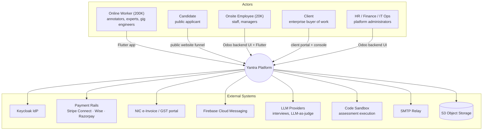

**Reasoning.** Five human roles, two fundamentally different access paths: heavy ORM users (employees, ops) go straight to Odoo's UI; scale users (workers, candidates) only ever see Flutter/web surfaces backed by the gateway. External integrations are all owned by specific services (never by Odoo directly), which section 2 makes explicit.

# 2. Container View — Microservice HLD (C4 Level 2)

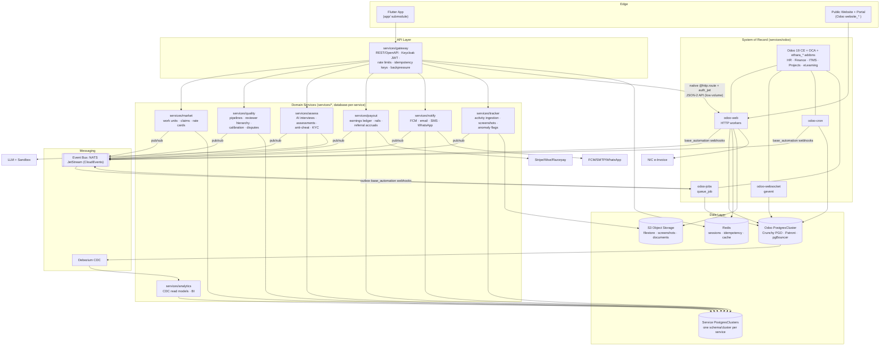

**Reasoning.** The gateway is the single choke point for all 200K-worker traffic — it is where auth, idempotency, and backpressure live, so no downstream component needs to defend itself against retry storms. Services never share databases and never write into Odoo's tables; Odoo's only inbound surfaces are its own UI, thin authenticated controllers, and queue-buffered event consumption. Odoo runs as four deployment roles (see [INFRASTRUCTURE.md](INFRASTRUCTURE.md)) because HTTP, websocket, cron, and async-job workloads scale on different axes.[^infrastructure]

# 3. Service-Layer Call Flows

## 3.1 Task Lifecycle — claim → submit → review → pay (the flagship flow)

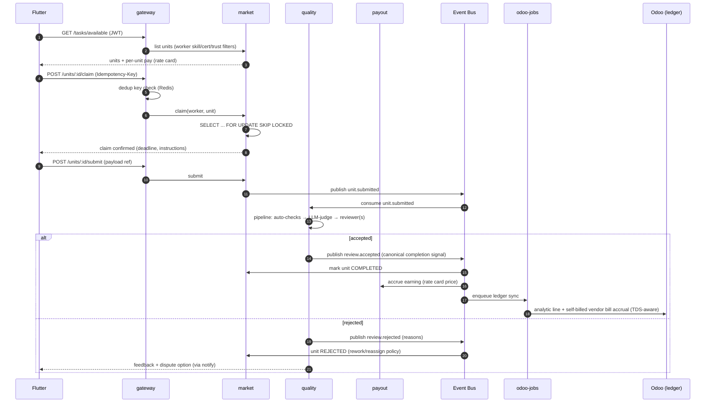

**Reasoning.** The completion signal emitted by quality — not the submission, not the claim — is the single canonical event that drives worker pay, client billing, and trust scoring (the Mercor architecture lesson in [REQUIREMENTS.md](REQUIREMENTS.md)). Odoo sees only serialized, queue-buffered aggregates; a 20K-concurrent claim storm never generates a single Odoo write.

## 3.2 Worker Onboarding — gated checklist

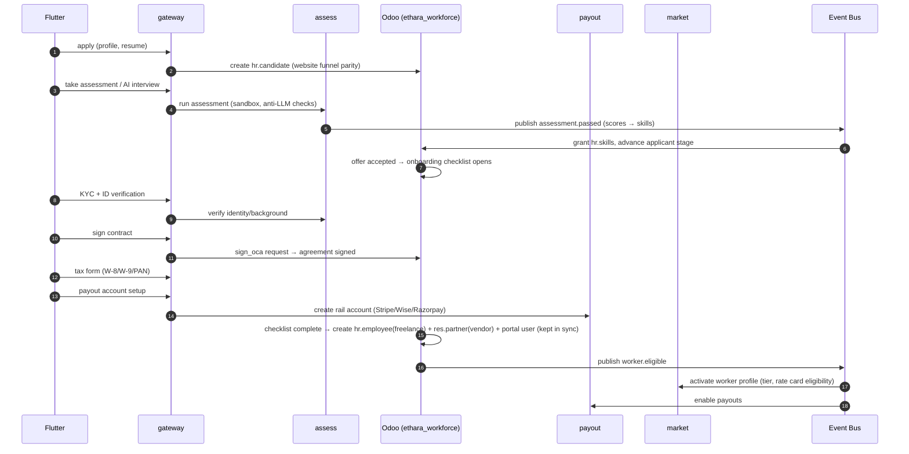

**Reasoning.** Odoo owns the compliance-bearing artifacts (signed agreement, tax form, employee/vendor identity) because they are HR/finance records; the services own the high-volume steps (assessment, KYC). Work eligibility is provably gated: `market` only activates on the `worker.eligible` event, which `ethara_workforce` emits only when every checklist item is complete.

## 3.3 Onsite Attendance — offline-first geofenced check-in

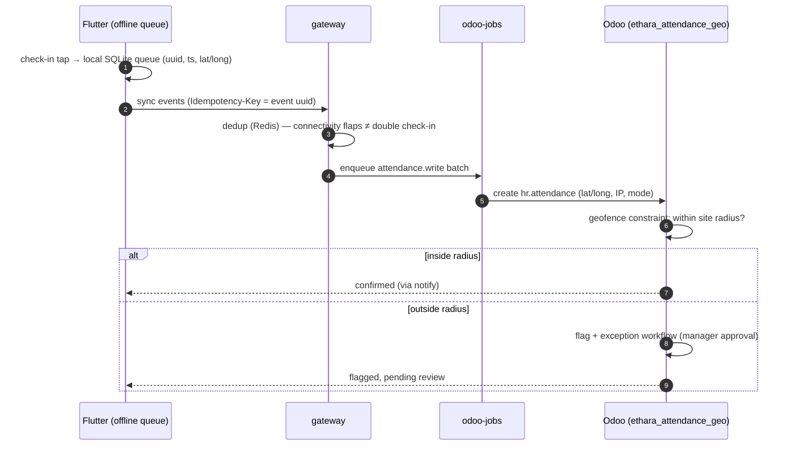

## 3.4 Payout Run — weekly cycle with ledger reconciliation

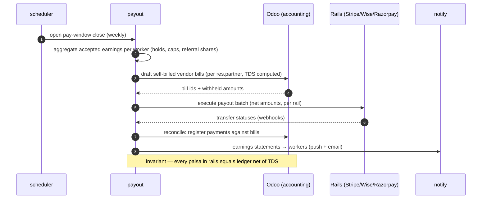

# 4. Event Topology

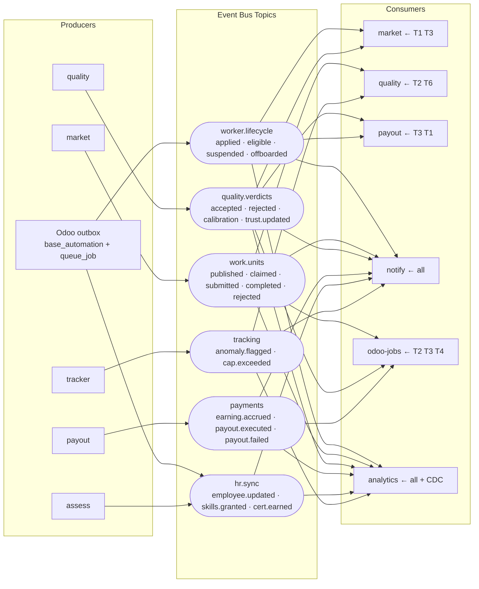

**Reasoning.** Topics are domain-aligned, not service-aligned, so consumers subscribe to business facts rather than implementation details. `notify` and `analytics` are universal consumers. Odoo both produces (HR master-data changes) and consumes (ledger-bound facts) — always through the outbox/queue bridge, never with a broker client in-process.

# 5. Data Design — ER Diagrams (orientation)

Database-per-service is a hard rule: each diagram below is a physically separate store. Cross-store references are **ids, not foreign keys** (e.g., every service row carrying `partner_ref` refers to Odoo's `res.partner.id` but is not FK-constrained across databases); consistency is eventual, via events. The diagrams in this section are condensed for orientation; the authoritative, implementation-grade schema — every table, every typed column, keys, checks, indexes, partitioning, retention, and roles — is [DATAMODEL.md](DATAMODEL.md), which supersedes this section for implementation purposes.

## 5.1 Odoo System of Record (condensed to platform-critical entities)

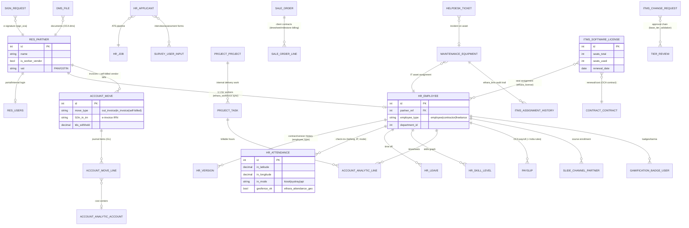

## 5.2 Marketplace + Quality + Tracker (service-owned stores)

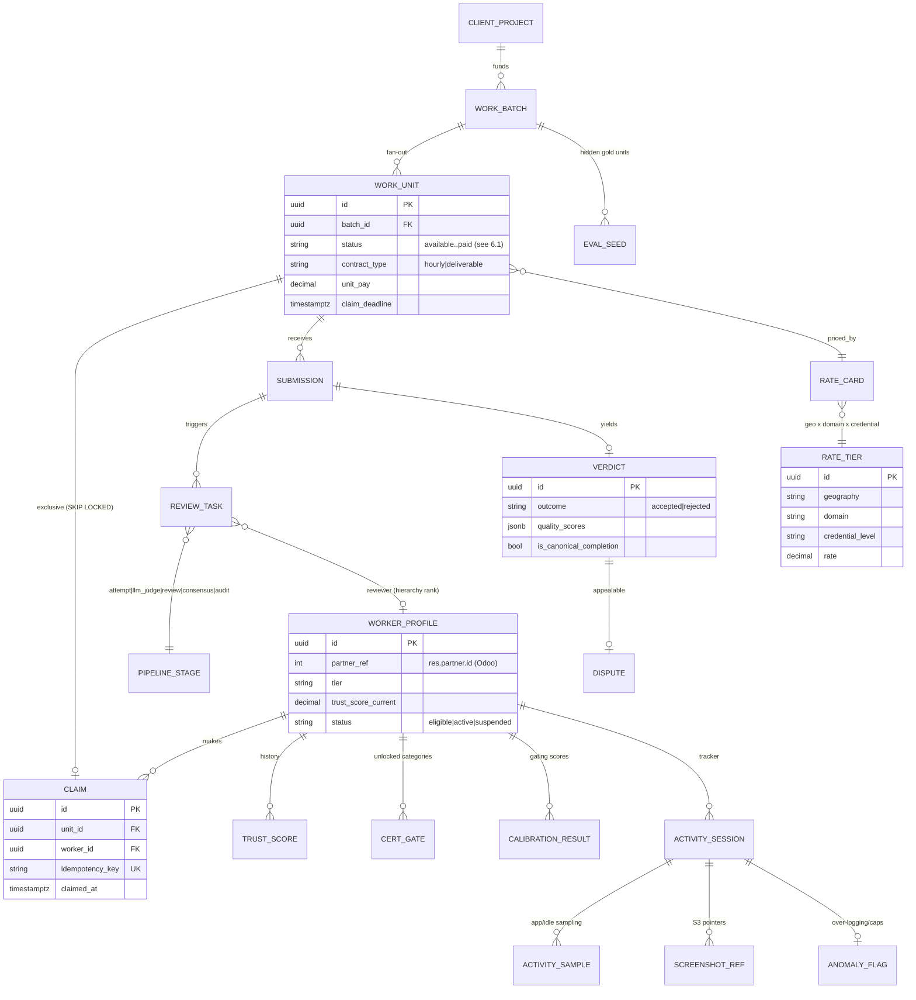

## 5.3 Assessment + Payout + Referral + Notify (service-owned stores)

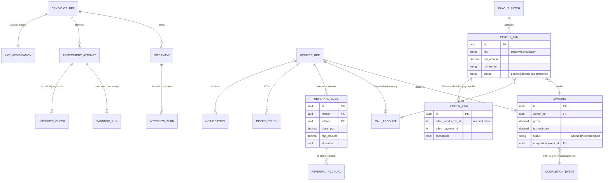

**Reasoning.** Three deliberate seams: (1) money truth is split — services compute and execute, but Odoo's GL is where every amount reconciles (`LEDGER_LINK` is the audit bridge); (2) `COMPLETION_EVENT`/`VERDICT.is_canonical_completion` encodes the single-source-of-truth rule in the schema itself; (3) high-churn rows (claims, samples, review tasks) never live in Odoo, keeping the ERP's tables cold enough for 20K-user interactive use.

# 6. State Machines

## 6.1 Work Unit Lifecycle

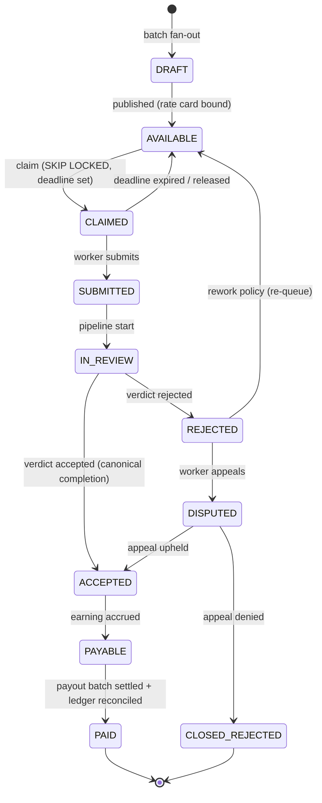

## 6.2 Worker Lifecycle

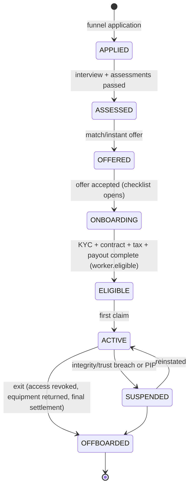

**Reasoning.** Both machines are event-sourced onto the bus (section 4): every transition is an auditable, timestamped fact — the property all four competitor platforms converge on and the substrate for trust scoring, dispute resolution, and statutory audit.

# 7. Deployment View

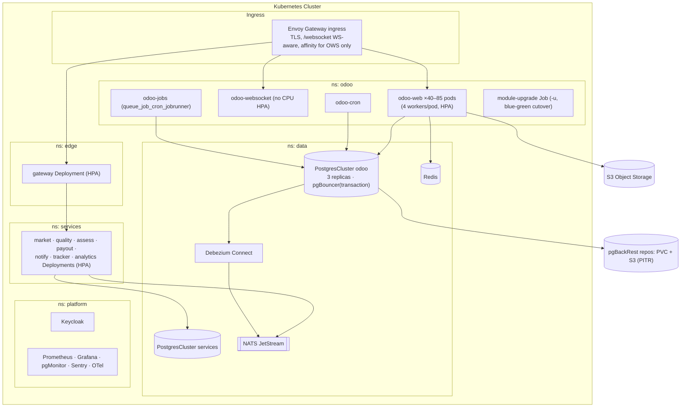

**Reasoning.** Namespaced by blast radius; the Odoo Postgres cluster is isolated from service databases so marketplace load can never starve payroll. Probe design, pooling modes, capacity formulas, and the upgrade-window caveat are specified in [INFRASTRUCTURE.md](INFRASTRUCTURE.md).[^infrastructure]

# 8. Cross-Cutting Design Decisions (trace)

| Decision | Where enforced | Documented |
|---|---|---|
| 200K workers never hit Odoo workers | gateway routing + services owning hot paths | [ARCHITECTURE.md](ARCHITECTURE.md)[^architecture] |
| Canonical completion signal drives pay + billing + trust | `VERDICT.is_canonical_completion`, `payments` topic, ledger sync job | §3.1, §5.3 |
| Idempotency everywhere a mobile client mutates | gateway dedup (Redis) + `CLAIM.idempotency_key` unique constraint | §3.1, §3.3, §5.2 |
| Database-per-service, ids-not-FKs across stores | schema ownership per submodule; CI forbids cross-DB DSNs | §5 |
| No REST framework inside Odoo | native `@http.route` + `auth_jwt` + JSON-2 only | [MODULES.md](MODULES.md)[^modules] |
| No broker client inside Odoo | outbox via `base_automation` + `queue_job` → bridge | §2, §4 |
| CE-only, license-audited dependencies | CI license manifest; AGPL rules for `ethara_*` | [MODULES.md](MODULES.md) |
| Every transition is an auditable event | state machines published to bus; analytics consumes all | §4, §6 |

[^architecture]: Yantra System Architecture
[^modules]: Odoo Module Selection Matrix
[^infrastructure]: Infrastructure and Deployment Topology
