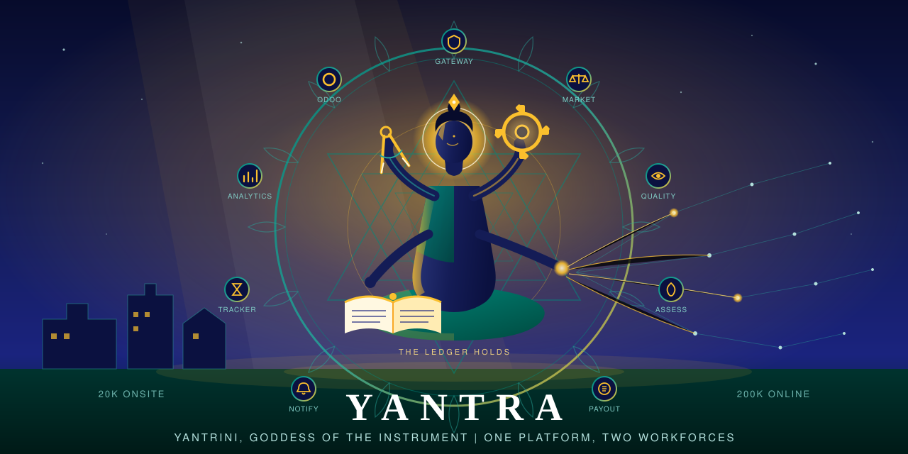
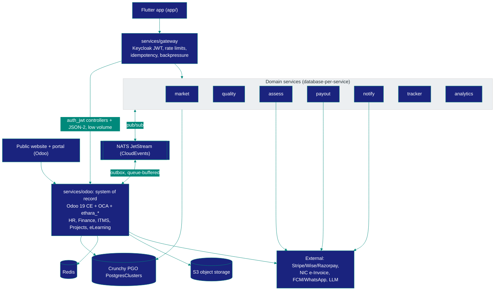
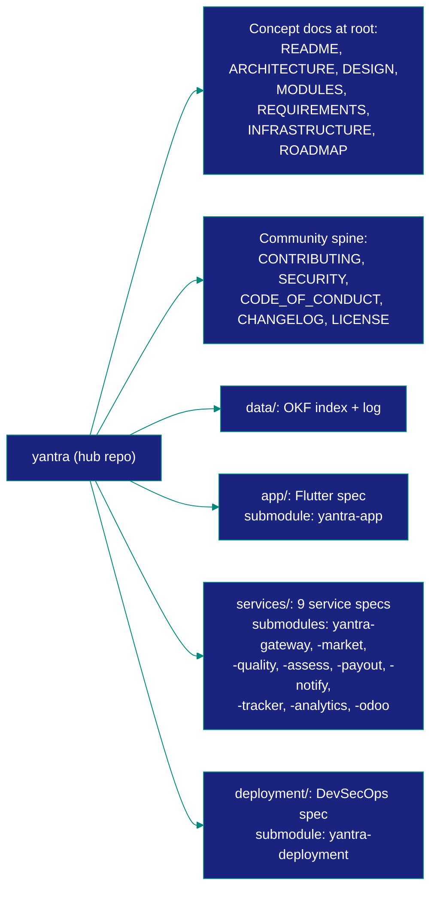

<p align="center">
  
</p>

<p align="center"><b>One platform, two workforces: the ERP that runs the company and the marketplace that runs the crowd.</b></p>

<p align="center">
  <a href="#license"></a>
  <a href="#summary"></a>
  <a href="#cloud-native-posture"></a>
  <a href="#evidence-status"></a>
  <a href="#repository-structure"></a>
</p>

<p align="center"><sub><a href="#abstract">Abstract</a> | <a href="#why-this-is-hard">Why this is hard</a> | <a href="#contributions">Contributions</a> | <a href="#summary">Summary</a> | <a href="#related-work">Related work</a> | <a href="#architecture">Architecture</a> | <a href="#cloud-native-posture">Cloud native</a> | <a href="#evidence-status">Evidence</a> | <a href="#threat-model">Threat model</a> | <a href="#repository-structure">Structure</a> | <a href="#reproduction">Reproduction</a> | <a href="#verification-and-quality-assurance">Verification</a> | <a href="#who-this-is-for">Who this is for</a> | <a href="#cite">Cite</a> | <a href="#contact">Contact</a></sub></p>

# Abstract

Yantra is Ethara.AI's unified workforce platform: a single system of record running HRMS, ITMS, Finance, and Operations on Odoo 19 Community Edition, wrapped in cloud-native microservices and a Flutter client, designed to track roughly 20,000 onsite employees and up to 200,000 online workers together. It targets functional parity with Mercor, Scale AI (Outlier/Remotasks), Multimango, and Handshake AI, whose observed capabilities form its requirements baseline. The design finding is that Odoo can be the ledger and HR truth at this scale only if the 200K-worker hot paths (task claims, activity tracking, payouts) live outside it in purpose-built services synchronized by events. Every capacity number in this bundle is a load-test hypothesis, not a measurement; see [Evidence status](#evidence-status).

# Why this is hard

The obvious shortcut is to put 200,000 gig workers straight into Odoo as portal users and assign them `project.task` records. It fails twice, by design. First, Odoo hard-codes portal users out of task assignment: `project.task.user_ids` carries a `share=False` domain added deliberately as a security fix, so a portal worker can never be a native assignee. Second, even if patched, a claim storm is the worst workload for Odoo's ORM: thousands of workers racing for the same task rows produces Postgres row-lock contention on hot records, a failure mode documented in production Odoo deployments at far smaller scale. The named failure mode is contended synchronous writes through a framework built for back-office concurrency, and the working design answers it with a separate marketplace service using `SELECT ... FOR UPDATE SKIP LOCKED` claims, idempotency keys at the gateway, and queue-buffered asynchronous writes into Odoo, whose full flow is drawn in [DESIGN.md](DESIGN.md).

# Contributions

1. A verified, CE-only Odoo 19 module matrix: every Enterprise-gated capability mapped to an OCA substitute or an in-house build, with module-level license obligations (LGPL-3/AGPL-3) recorded, in [MODULES.md](MODULES.md).
2. A dual-workforce architecture that keeps Odoo as the single financial and HR system of record while excluding the 200K-worker hot paths from its process boundary entirely, in [ARCHITECTURE.md](ARCHITECTURE.md).
3. A competitor-derived requirements checklist, the observed capability union of four commercial workforce platforms, each capability mapped to an owning component, in [REQUIREMENTS.md](REQUIREMENTS.md).
4. A complete design surface: C4 views, sequence flows, event topology, and state machines in [DESIGN.md](DESIGN.md), backed by an implementation-grade data model in [DATAMODEL.md](DATAMODEL.md) covering every store, table, and typed column with keys, constraints, indexes, partitioning, retention, and roles.
5. A production topology for Odoo on Kubernetes at unprecedented scale, including two documented traps (pgBouncer session-mode default vs `queue_job` LISTEN/NOTIFY, and the Crunchy image-licensing posture with the Percona fork as exit), in [INFRASTRUCTURE.md](INFRASTRUCTURE.md).

# Summary

| Property | Value |
|---|---|
| ERP core | Odoo 19.0 Community Edition only, support horizon September 2028 |
| Enterprise code | None, hard constraint, CI-gated (no OEEL-1) |
| Scale target | 20K onsite (1,000-2,000 concurrent) + 200K online workers (never touch Odoo workers) |
| Frontend | Flutter (single codebase, gateway-only networking), spec in [app/](app/) |
| Backend | 9 microservices, one git submodule each, database-per-service, spec in [services/](services/) |
| DevSecOps | Dedicated submodule, policy-as-code, spec in [deployment/](deployment/) |
| Database | PostgreSQL on Kubernetes, Crunchy Postgres Operator (Patroni, pgBackRest, pgBouncer) |
| Identity | Keycloak (CNCF), OIDC for staff, JWT for workers and services |
| Messaging | NATS JetStream (CNCF) with CloudEvents envelopes |
| India compliance | GST e-invoicing (IRN) and TDS in CE core; GSTR filing and statutory payroll built in-house |
| Knowledge format | OKF v0.2 bundle, concept docs at root, reserved files in [data/](data/) |

# Related work

| Axis | Mercor | Scale (Outlier/Remotasks) | Multimango (TELUS) | Handshake / Handshake AI | Yantra |
|---|---|---|---|---|---|
| AI interview vetting | Yes, scored video with retakes | No | No | No | Planned, service/assess |
| Task marketplace with per-unit pay | No (contracts) | Yes | Yes | No (fellowships) | Yes, services/market |
| Multi-stage quality pipeline | Human audit layer | Yes, consensus + LLM judge + hierarchy | Basic | Rubric evals (enterprise) | Yes, services/quality |
| Tracked time with screenshots | Yes (Insightful) | No | Self-reported | No | Yes, services/tracker |
| Multi-rail global payouts | Stripe + Wise | PayPal/Airtm/ACH | TELUS payroll | Platform payroll | Stripe Connect + Wise + Razorpay |
| Referral earnings-share | Yes, capped percent | Basic | No | No | Yes, ethara_referral |
| Full ERP (HR + finance + ITSM) behind the marketplace | No | No | No | No | Yes, Odoo 19 CE |
| Onsite + online workforce on one system | No | No | No | No | Yes, the defining goal |

The differentiating claim is the last two rows: none of the four platforms runs its marketplace and its complete enterprise back office (ledger, payroll, assets, helpdesk) on one auditable system of record. Capability citations for every competitor row are in [REQUIREMENTS.md](REQUIREMENTS.md).

# Architecture

Two workforces, two paths. Onsite employees use Odoo's backend directly; online workers only ever reach the platform through Flutter, the gateway, and domain services, with state synchronized into Odoo asynchronously over the event bus. Full views are in [DESIGN.md](DESIGN.md) and [ARCHITECTURE.md](ARCHITECTURE.md).



# Cloud native posture

Yantra follows the CNCF Cloud Native Trail Map end to end: OCI containerization, GitOps CI/CD (Argo CD), Kubernetes + Helm, observability on Prometheus/OpenTelemetry, Envoy-based ingress with CoreDNS, Cilium CNI with default-deny NetworkPolicies and Kyverno policy-as-code, Crunchy-operated PostgreSQL, NATS JetStream + CloudEvents messaging, Harbor registry on containerd, and sigstore-signed artifacts with SBOM + SLSA provenance. Keycloak and NATS were already first-choice components and are CNCF projects. The full step-by-step trail map alignment table, with the CNCF project chosen at each step and its status, lives in [INFRASTRUCTURE.md](INFRASTRUCTURE.md); enforcement (image signing, policy gates, scorecards) is specified in [deployment/](deployment/).

# Evidence status

This is the single canonical statement of what is measured versus specified. Yantra is at specification stage: every document in this bundle is design, not deployment. Module availability claims are measured facts, verified by direct inspection of the `odoo/odoo` 19.0 tree and each OCA repo's 19.0 branch on 2026-09-10, with absence-from-CE confirmed per module. Competitor capabilities are sourced observations, cited in [REQUIREMENTS.md](REQUIREMENTS.md). All capacity figures (worker counts, pod counts, pool sizes) are derived from Odoo's published sizing formulas and are hypotheses pending the load-test harness defined in [deployment/](deployment/); no load test has run, and no public Odoo deployment at 20K internal plus 200K portal users exists to copy, so these numbers carry no measured evidence yet. All eleven submodules (app, nine services, deployment) are created under EtharaOrion, seeded with their specifications, and wired into this repository via relative-URL git submodules. Pending human gates: mascot election for the hero art (a labeled placeholder ships at `images/hero.svg`), replacement of placeholder CODEOWNERS team slugs, and the open decisions table in [ROADMAP.md](ROADMAP.md). Disposition: DRAFT, cleared by Phase 0 infrastructure standing up and the first load-test evidence landing.

# Threat model

| Threat | Control |
|---|---|
| Portal data exposure (worker A reads worker B) | `portal.mixin` + explicit `ir.rule` scoping on every worker-facing model; penetration tests each phase gate ([SECURITY.md](SECURITY.md)) |
| Claim-storm abuse and retry floods | Gateway rate limits, idempotency keys, backpressure; `FOR UPDATE SKIP LOCKED` claim serialization |
| Payment fraud (double payout, over-logging) | Canonical completion signal as sole payout trigger; tracker caps and anomaly flags; ledger reconciliation invariant (rails equal ledger net of TDS) |
| Assessment cheating (LLM-written answers) | Anti-LLM detection, seeded evaluation units, calibration gating, human audit layer (services/quality) |
| License contamination (Enterprise/OEEL-1 code) | CI license audit; policy-as-code refuses OEEL artifacts; AGPL obligations tracked per addon ([MODULES.md](MODULES.md)) |
| Supply chain (images, dependencies) | Digest-pinned images, sigstore signing, SBOM + SLSA provenance, Harbor scanning ([deployment/](deployment/)) |
| Secrets leakage | External-secrets + vault, CI secret scanning, no secrets in any submodule |
| Data-plane blast radius | Namespace isolation, default-deny NetworkPolicies, Odoo cluster separated from service clusters |

# Repository structure



# Reproduction

The bundle's claims are checkable from a clone. Verify OKF conformance (every non-reserved root `.md` parses YAML frontmatter with a `type` key) and byte hygiene with:

```bash
git clone https://github.com/EtharaOrion/yantra && cd yantra
for f in *.md; do head -1 "$f" | grep -qx -- '---' || echo "FAIL frontmatter: $f"; done
grep -rn --include='*.md' -P '[^\x00-\x7F]' README.md && echo "FAIL ascii" || echo "ok ascii"
```

Module-availability claims reproduce against the pinned upstream refs: each module named CE-core in [MODULES.md](MODULES.md) exists under `https://github.com/odoo/odoo/tree/19.0/addons/<module>`, and each Enterprise-gated module 404s there. Mermaid diagrams render on GitHub natively.

# Verification and quality assurance

Gates that hold today: OKF frontmatter conformance across all concept documents; single-line paragraph discipline; module claims pinned to verifiable upstream trees; competitor claims carrying source citations; per-phase verification criteria defined before implementation in [ROADMAP.md](ROADMAP.md). Honest limitations: no code exists yet in any submodule; capacity numbers are formula-derived, not load-tested; the OCA appraisal module and geolocation backport are pending 19.0 ports; GSTR filing and India statutory payroll are in-house builds with no OSS reference implementation; the hero art awaits human mascot election; CNCF alignment is specified but not yet enforced by running pipelines.

# Who this is for

Ethara.AI engineering builds from this bundle: start at [ROADMAP.md](ROADMAP.md) Phase 0 and open the submodule repos. Ethara.AI leadership evaluates scope and cost from [MODULES.md](MODULES.md) (build-vs-OCA matrix) and the open decisions in [ROADMAP.md](ROADMAP.md). Platform architects elsewhere evaluating Odoo-at-scale should read [INFRASTRUCTURE.md](INFRASTRUCTURE.md) for the two documented traps and the capacity method. Contributors start at [CONTRIBUTING.md](CONTRIBUTING.md).

# Cite

```bibtex
@misc{yantra2026,
  title  = {Yantra: A Unified Onsite and Online Workforce Platform on Odoo Community Edition},
  author = {{Ethara.AI}},
  year   = {2026},
  note   = {Knowledge bundle: architecture, module matrix, and scale design for 20K onsite and 200K online workers}
}
```

# License

MIT, see [LICENSE](LICENSE). The license covers this knowledge bundle and original non-addon code; Odoo addon submodules carry their own LGPL-3/AGPL-3 obligations documented in [MODULES.md](MODULES.md).

# Contact

Ethara.AI: https://github.com/EtharaOrion. Security disclosures: security@ethara.ai per [SECURITY.md](SECURITY.md). Contributions: [CONTRIBUTING.md](CONTRIBUTING.md). Conduct: conduct@ethara.ai per [CODE_OF_CONDUCT.md](CODE_OF_CONDUCT.md).

---

## Copyright

Copyright (c) 2026 Green Rider Technology LLP (Ethara AI). All rights reserved.
