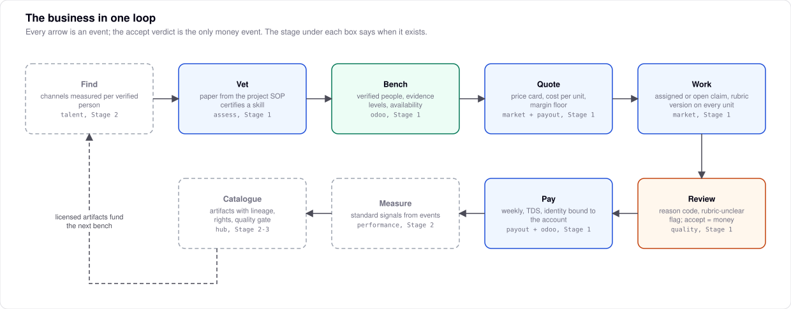
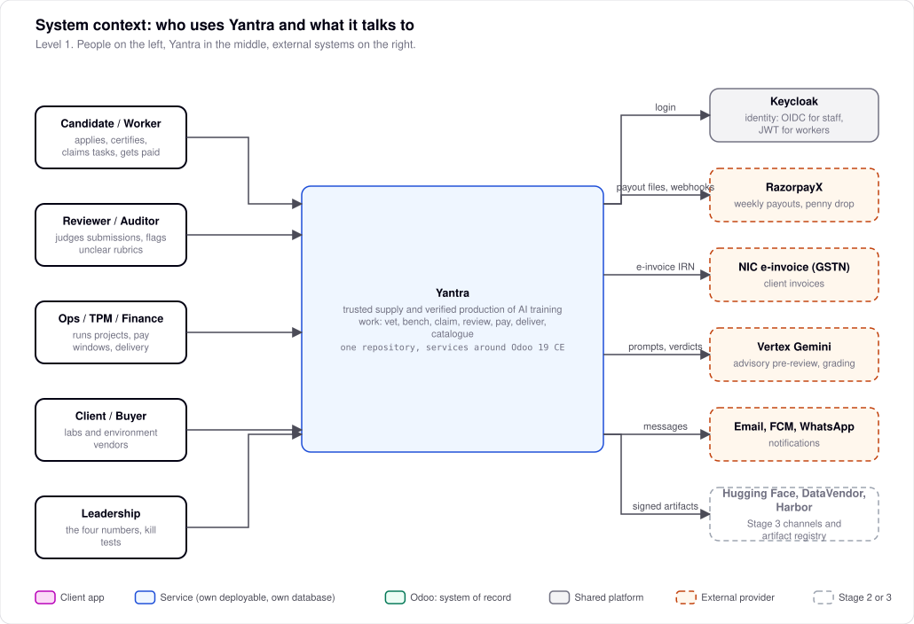
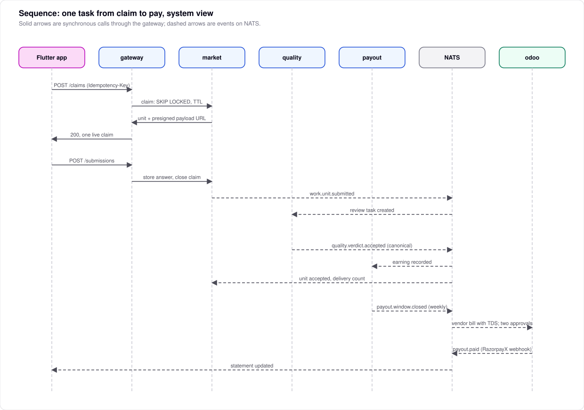
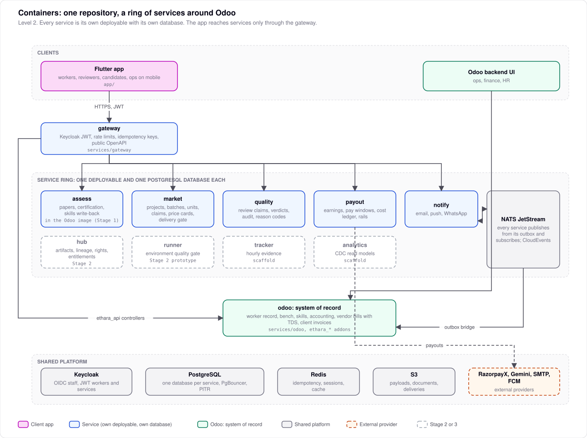
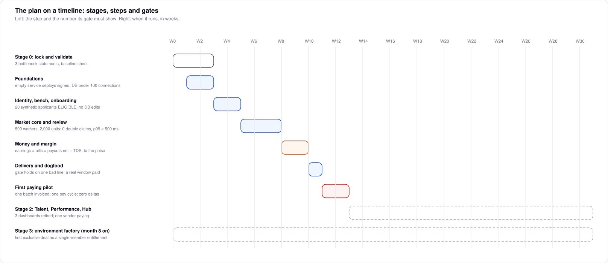

# Understanding Yantra

A plain-language guide. No prior knowledge of the project is assumed. Each section builds on the one before it; every diagram can be opened and edited in draw.io.

## Contents

1. Yantra in one minute
2. The problem it solves, as a story
3. The words you need
4. Who uses it and what each person sees
5. The loop, step by step, with real numbers
6. How it is built, in plain words
7. The technology, in plain words
8. The plan, in four stages
9. What is new compared with the repository documents
10. Questions you will be asked, with answers
11. Where to go next

---

## 1. Yantra in one minute

Yantra is Ethara's platform for selling **trusted human work to AI companies**. AI labs and the vendors who build training environments need thousands of small, careful pieces of work: judge a caption, grade a transcript, rank two answers, test a task in a simulated ERP. They need it done by people whose skill has been checked, reviewed for quality, delivered in a clean file, and invoiced per accepted piece.

Yantra does the whole chain on one system:

- **finds** people and **proves** what they can do with a test,
- keeps them on a **bench** so the next project staffs in days, not weeks,
- puts them on **work** in small units with the price and the rules visible,
- **reviews** every unit, and only an accepted unit creates money,
- **pays** weekly in India with tax handled,
- **delivers** the accepted work to the client with a manifest and an invoice,
- and, later, turns accepted work into **artifacts** (datasets, environments) that can be licensed.

It is built as **one code repository** with **a ring of small services** around **Odoo** (the accounting and HR system Ethara already runs), with a **Flutter app** as the only thing workers see.

---

## 2. The problem it solves, as a story

A lab in the US wants 5,000 Hindi audio clips captioned and checked within three weeks. Today this means: find captioners on WhatsApp, test them by hand, send them a Google Sheet, chase submissions, review in another sheet, argue about which rubric version applied, pay by bank transfer with TDS worked out by hand, and send the client a zip. Nobody knows the margin until the invoice is paid. When the project ends, the people disappear and the next project starts from zero.

With Yantra the same job looks like this:

1. Ops creates a **project** from the client's brief: the task form, the rubric, the pay per unit, the price per unit. The system warns if the margin is below the floor.
2. The 5,000 clips are imported as **units** in a **batch**. A dry run reports every bad line before anything goes live.
3. Captioners on the **bench** who hold a live Hindi-audio certification see the batch in the app, with the pay shown before they claim. Each person holds one claim at a time; a claim expires if abandoned.
4. Each submission goes to a **reviewer** who never sees their own work, judges it against the rubric version stamped on the unit, and must give a **reason code** on any rejection. Ten percent of accepts are re-checked by an auditor.
5. An **accepted** verdict creates an **earning**. Nothing else does.
6. On Friday night the **pay window** closes. Finance sees one self-billed bill per worker with TDS already computed, approves with a second person, and the money goes out through RazorpayX. The books are reconciled to the paisa before anyone sees a statement.
7. The accepted units pass the **delivery gate** (every line validated against the schema), ship with a **manifest**, and the **invoice** is accepted units times the price. The **margin report** sits next to it.
8. The captioners go back to the bench. Next time, staffing takes days.

Every step above is also a screen in the mockups and a row in the user flows.

---

## 3. The words you need

| Word | Meaning here |
|---|---|
| **Unit** | The smallest piece of paid work: one clip, one caption, one comparison. Has a schema (what the form looks like), a pay, a price and a rubric version. |
| **Batch** | A set of units imported together under one project, with one mode (open claim or assigned) and one frozen pay and price. |
| **Project** | The client engagement: schema, rubric, quality policy, rate card (what we pay), price card (what we charge). |
| **Claim** | A worker taking one unit to work on. One live claim per worker, with a time limit (TTL). A retry can never create a second claim (idempotency). |
| **Verdict** | The reviewer's decision on a submission: accept, needs edits, reject. The **canonical accept** is the only event that creates money. |
| **Reason code** | A short code required on every rejection (for example "timing", "glossary", "spec changed by client"). Codes marked client-caused are billable. |
| **Rubric version** | The exact version of the judging rules a unit was reviewed against. Stored on the unit so quality history survives a rule change. |
| **Bench** | The pool of verified contractors with their skills, evidence level, availability and past quality. People return to it when a project ends. |
| **Evidence level** | How we know a skill: *claimed* (they said so), *verified* (they passed our test), *proven* (their accepted work shows it). Never mixed in one field. |
| **Certification** | A pass on an assessment paper that opens a category of work. Has a retake policy. |
| **Price card / rate card** | Price card: what the client pays per accepted unit. Rate card: what the worker is paid per accepted unit (plus review and audit pay). |
| **Margin floor** | The minimum margin a batch may run at. Below it, the system warns and requires a recorded approval. |
| **Pay window** | The weekly period (Saturday to Friday, Indian time) whose accepted earnings are paid together. |
| **TDS** | Tax deducted at source: Indian withholding tax on contractor payments, computed on every vendor bill. |
| **Vendor bill** | The self-billed invoice Odoo raises on the worker's behalf for one pay window. The ledger record behind each payout. |
| **Delivery gate** | The check that every accepted unit matches the client's schema before the batch ships. One bad line holds the batch. |
| **Manifest** | The file shipped with a delivery: checksums, provenance, rubric version, counts. |
| **The four numbers** | Days to staff a project, idle cost, first-pass acceptance, cost per accepted unit. Reported to leadership from the first delivery onward. |
| **Environment** | (Stage 3) A packaged simulated task world, for example an Odoo-based ERP replica, that labs use to train and test agents. |
| **Hub** | (Stage 2 and 3) The catalogue of artifacts with lineage, rights and entitlements. |
| **Quality gate (runner)** | (Stage 2 and 3) Automated checks on an environment: deterministic replay, pass-rate within a band, reward-hack audit. A finding is a hard fail. |
| **Entitlement** | (Stage 3) Who may use an artifact and how: exclusive (single member) or shared. |
| **Gate** | Every step of the plan ends with one: a measurable result that must be true before the next step starts. |

---

## 4. Who uses it and what each person sees

| Person | Door in | What they do | Screens |
|---|---|---|---|
| **Candidate, then worker** | Flutter app | apply, take the paper, finish the onboarding checklist, claim and work units, see earnings and statements | apply, assessment, onboarding checklist, task list, task runner, earnings |
| **Reviewer, auditor** | Flutter app | claim the next submission, judge, give a reason code, flag an unclear rubric, re-check audit samples | review console |
| **Ops, TPM** | Odoo backend and app | set up projects, import batches, publish, watch the bench and the queue, ship deliveries | projects and batches, the bench, delivery |
| **Finance** | Odoo backend | close the pay window, approve bills, run payouts, reconcile, invoice clients | pay window, invoice, margin report |
| **Client, buyer** | manifest and invoice now; a console in Stage 2 | receive deliveries, see acceptance and quality, give feedback | client console (Stage 2) |
| **Leadership** | the four numbers | decide to continue, change course or stop | leadership dashboard |

Each person has a flow in [User flows](03-user-flows.md).

---

## 5. The loop, step by step, with real numbers

The figures below are an **example**, not a quote. They show how money moves and where margin comes from.

**The project.** 2,000 Hindi audio captions. Client price: ₹60 per accepted unit. Worker pay: ₹28 per accepted unit. Review pay: ₹6 per review. Audit sample: 10% of accepts at ₹6. Rail fee: about ₹0.50 per unit. Levy line: ₹0.50 per unit.

**Step 1, setup.** Ops creates the project with the schema (audio player plus a text box and three checkboxes), rubric v1, the quality policy (single review plus 10% audit), the rate card and the price card. The system computes the expected cost per unit (28 + 6 + 0.6 + 0.5 + 0.5 = ₹35.60) against the price (₹60): expected margin 40.7%. The floor for this client is 30%, so no warning.

**Step 2, publish.** 2,000 units imported; the dry run flags 3 bad lines; ops fixes the file and publishes. Publishing freezes ₹28 and ₹60 on the batch so nobody can change them under a worker's feet.

**Step 3, work.** 180 certified captioners see the batch. Each claim holds one unit for 45 minutes. Over nine days 2,000 units are submitted; 1,860 are accepted first time, 120 need edits and are resubmitted, 20 are rejected with reason codes (14 worker-caused, 6 client-caused because the client changed the glossary; those 6 are billable rework).

**Step 4, review.** 2,140 reviews happen (2,000 plus 120 resubmissions plus 20 audits beyond the sample). Each accepted unit creates one earning of ₹28 for the worker and ₹6 for the reviewer. Two reviewers flag "rubric unclear" on the same sentence; the TPM issues rubric v2 within two days; every unit still records which version judged it.

**Step 5, pay.** Two Friday windows close during the project. In the first, 180 workers have earnings; finance sees 180 self-billed vendor bills with 10% TDS computed (for a ₹5,600 week: ₹560 withheld, ₹5,040 paid). Two people approve. RazorpayX pays on Wednesday. The nightly check shows earnings = bills = payouts net + TDS, to the paisa.

**Step 6, deliver.** 1,986 units pass the delivery gate (14 worker-rejected units were re-assigned and accepted later). The manifest lists checksums and rubric versions. The invoice is 2,000 accepted units × ₹60 = ₹120,000, plus 6 billable rework units.

**Step 7, margin.** Cost lines: worker pay ₹56,000, review ₹12,840, audit ₹1,200, rail ₹1,000, levy ₹1,000: ₹72,040. Margin ₹47,960, 40.0%, within one point of the quote. The report shows this per batch, every week, before the client pays.

**Step 8, the four numbers.** Days to staff: 2 (baseline 11). Idle cost: ₹0 (people returned to the bench). First-pass acceptance: 93%. Cost per accepted unit: ₹36.02.

---

## 6. How it is built, in plain words

**One system of record.** Odoo 19 Community Edition is the accounting and HR system Ethara already runs. It stays the place where people, skills, bills, invoices and the ledger live. Anything about money or a person ends up in Odoo.

**A ring of services.** Everything that is high-volume or specialised runs outside Odoo as its own small program, called a service: the gateway, assess, market, quality, payout, notify, and later hub and runner. Each service has its own database and its own deployment, so a surge of task claims cannot slow down the accounts, and a change to one service does not require redeploying the others.

**Why not put everything in Odoo?** Two reasons. Odoo deliberately forbids portal (external) users from being assigned to tasks, so a marketplace inside Odoo would fight the product. And the task-claim workload (hundreds of people grabbing units at once) is contended, bursty writing, which is the one thing a shared ERP database handles worst. Keeping that path in `market`, on its own database, protects the rest.

**One door for the app.** The Flutter app never talks to a service directly. It talks to the gateway, which checks the login token, rate-limits, and makes every write safe to retry (a retried claim returns the same claim, never a second one).

**Events, not shared tables.** When something happens in a service (a unit is submitted, a verdict is accepted, a window closes), the service writes an event into its own outbox in the same database transaction, and a relay publishes it on NATS, the message bus. Other services and Odoo subscribe. Nobody reads another service's tables. If a consumer is down, the event waits.

**One repository.** All of this lives in one git repository: the app, the services, the Odoo addons, the shared contracts, the deployment charts. A change to a contract and every consumer of it lands in one pull request, so nothing drifts. The build only tests and ships what changed.

**Identity.** Keycloak is the single sign-in: staff log into Odoo with it, workers and services get tokens from it.

---

## 7. The technology, in plain words

| Technology | What it is | What it does in Yantra | Why this one |
|---|---|---|---|
| **Odoo 19 Community Edition** | An open-source ERP written in Python | people, skills, bench, accounting, vendor bills, TDS, invoices, GST e-invoicing | Ethara already runs it; India localisation is built in; no paid edition |
| **Python 3.12 with FastAPI** | Language and web framework for the services | gateway, assess, market, quality, payout, notify, hub, runner | same language as Odoo; small, fast, well understood by the team |
| **PostgreSQL** | Relational database | one database per service plus Odoo's, through PgBouncer connection pooling | the claim path needs row locking that Postgres does well (`SKIP LOCKED`) |
| **Flutter** | Google's UI toolkit, one codebase for web and mobile | the worker, reviewer and onboarding app | the assessment app already exists in Flutter; mobile comes from the same code |
| **Keycloak** | Open-source identity server | single sign-in for staff, tokens for workers and services | already built for Yantra; standard OpenID Connect |
| **NATS JetStream** | A message bus with persistence | carries events between services and into Odoo | light to run, replays events, chosen in the repository's roadmap |
| **Redis** | In-memory key-value store | idempotency keys, sessions, cache | the standard choice; small footprint |
| **S3-compatible object storage** | File storage | task payloads, documents, deliveries, artifacts | bytes never pass through the services; presigned links expire in five minutes |
| **Razorpay (RazorpayX)** | Indian payments provider | weekly payouts, bank verification by penny drop | Ethara's existing provider; domestic rails, no foreign exchange |
| **Vertex Gemini** | Google's hosted large language model | advisory pre-review and grading help; never the final verdict | existing client and cost ledger; no third-party proxy in the data path |
| **Kubernetes with Istio** | Container orchestration and ingress | runs every service and Odoo; TLS and routing | already deployed |
| **Helm, Argo CD** | Packaging and GitOps delivery | one chart per service; the cluster follows the repository | standard, auditable deploys |
| **Harbor, cosign, SBOM** | Container registry, image signing, bill of materials | every image signed and scanned; Stage 3 artifacts signed the same way | supply chain is where incumbents got hurt [R] |
| **GitHub Actions** | CI | tests only what changed, contract tests, image builds | lives with the repository |
| **Prometheus, Grafana, Loki, OpenTelemetry, Sentry** | Metrics, dashboards, logs, traces, errors | one trace from the app to the ledger; alerts on the numbers in the plan | already deployed |
| **OpenEnv, Hugging Face Hub** | (Stage 3) An environment packaging standard; a public model and dataset hub | artifact contract; free-tier channel | what buyers already use |

The full table with what was not chosen is in [Tech stack](04-tech-stack.md).

---

## 8. The plan, in four stages

| Stage | When | What it delivers | How we know it is done |
|---|---|---|---|
| **Stage 0: lock and validate** | weeks 0 to 2, in parallel | the decisions signed; baselines from 2 or 3 live projects; interviews with 5 environment vendors and 2 labs; counsel and the chartered accountant on file; the SOC 2 window opened; the bench flow tried on a spreadsheet | 3 quantified bottleneck statements from buyers; a baseline sheet |
| **Stage 1: the working loop** | weeks 1 to 12 | foundations (repository, CI, charts, bus, databases); identity, bench and onboarding; market core and review; money and margin; delivery and an internal dogfood batch; the first paying pilot | one real batch delivered and invoiced; one real pay cycle; zero double claims; zero reconciliation differences; the second batch staffed faster than the baseline |
| **Stage 2: Talent, Performance, Hub** | weeks 13 to 30 | resume parsing and matching; standard performance signals for everyone; an internal catalogue of artifacts; a quote engine with tiers; the runner prototype; a client console; mobile | three CSV dashboards retired; one environment vendor paying; the gate rejects a hackable environment |
| **Stage 3: the environment factory** | month 8 on | one vertical (for example Odoo-based ERP replicas or Indian finance workflows); authoring tasks; the quality gate in production; signed artifacts; entitlements; hubs as channels | the first environment passes a buyer's bar; the first exclusive deal recorded as a single-member entitlement |

**The six steps of Stage 1**, each with a gate:

1. **Foundations** (weeks 1 to 2): the repository laid out, CI, a chart per service, NATS, Keycloak wired, a database per service, the shared contracts package, the claim-storm test harness. Gate: an empty `market` service deploys to staging through the pipeline, signed, with health checks and a trace.
2. **Identity, bench, onboarding** (weeks 3 to 4): the gateway; the worker record, agreements, consent, documents and the bench record in Odoo; assessment events and the certification gate; payout setup inside the app. Gate: 20 synthetic applicants reach ELIGIBLE with no manual database edits.
3. **Market core and review** (weeks 5 to 7): projects, batches, units, claims, submissions, the review console, reason codes, the price card and the margin floor. Gate: 500 simulated workers on 2,000 units, zero double claims, p99 claim under 500 ms.
4. **Money and margin** (weeks 8 to 9): earnings, the weekly window, vendor bills with TDS, two-person approval, RazorpayX in sandbox, reconciliation, the margin report. Gate: earnings = bills = payouts net + TDS, to the paisa.
5. **Delivery and dogfood** (week 10): the delivery gate, manifest, invoice, retention purge; an internal batch of 300 to 500 units worked by existing taskers; the four numbers. Gate: the gate holds a batch on one bad line; a real pay window is paid.
6. **First paying pilot** (weeks 11 to 12): the first paying client project; people return to the bench; the next batch staffed from it. Gate: one real batch delivered and invoiced; one real pay cycle; zero differences.

**The four numbers** are what leadership sees from step 5 onward. **The kill tests** say when to change course: fewer than 3 signed vendor customers in two quarters; prices or volumes falling two quarters in a row; an exclusivity premium under 2x; a bench that is not faster and cheaper than the baseline after the pilot.

---

## 9. What is new compared with the repository documents

The Yantra repository (README, ARCHITECTURE, ROADMAP, MODULES, DATAMODEL, INFRASTRUCTURE) is the point of truth. This pack keeps its shape, names, service list and integration rules, and proposes five things. Each stays a proposal until accepted.

| Proposal | What the repository says today | What this pack proposes | Why |
|---|---|---|---|
| Order of work | Phases 1 to 3 (HRMS, Finance, ITMS) before Phases 4 to 6 (the marketplace) | a thin slice of Phases 0, 4 and 5 first, as a working loop with real money; Phases 1 to 3 continue in parallel on the existing addons | the loop proves the business model; the ERP track does not depend on it |
| Repository layout | one git submodule per service | fold the submodules into one repository | a contract change and all its consumers land in one pull request |
| Payout rail | Stripe Connect primary, Razorpay for India | Razorpay first; Stripe Connect when a non-Indian entity exists | the paying entity is Indian |
| Two new services | nine services | add `hub` (artifacts, rights, entitlements) and `runner` (the environment quality gate) | the Stage 3 business line needs them |
| Where assess runs in Stage 1 | `services/assess` as its own service | the Assessment v2 engine keeps running inside the Odoo image behind its own contract until Stage 2 | it already works there; moving it before the loop runs is cost without evidence |

The year-one size (3,000 registered, 500 concurrent) sits inside the repository's envelope (20K onsite, 200K online), which stays the design ceiling.

---

## 10. Questions you will be asked, with answers

**Why not build everything inside Odoo?** Odoo forbids external users from being task assignees, and the task-claim path is contended writing that a shared ERP database handles worst. The marketplace runs beside Odoo and syncs money and people into it through events.

**Why services from day one for a small team?** Hot paths are isolated from the first batch, teams ship independently, and the repository already specifies this shape. The cost is about three extra weeks in Stage 1 and a named DevOps owner at two days a week. The shared code (outbox, idempotency, tracing, auth) lives in one package so no service rewrites it.

**Why one repository if the services are separate?** Separate deployables, one place to read and change them. A contract change and every consumer land together; CI only tests what changed.

**What stops two workers getting the same unit?** The claim is one short database transaction using `SKIP LOCKED`; a unique index makes a second claim on the same unit impossible; a retried request carries the same idempotency key and gets the same answer.

**What stops someone being paid twice?** Only the canonical accept verdict creates an earning; the earning stores the verdict event id; the nightly reconciliation alerts on any difference and never changes numbers by itself.

**Why Razorpay and not Stripe?** The paying entity is Indian, so Stripe Connect transfers are not available to it. Razorpay is already Ethara's provider and pays domestic bank accounts without foreign exchange.

**Why only 3,000 workers in year one when the repository says 200,000?** 200,000 is the design ceiling and stays so. Year one is sized to what the first clients need, with the load test at the ceiling kept as the Phase 5 check. A comparable platform runs about 30,000 weekly active workers [E].

**How does the client get the data?** As a JSONL file plus a manifest, after the delivery gate validated every line. In Stage 2 through a console that also shows acceptance rates and quality reports.

**What is an environment, and why is it a business?** A packaged simulated task world (for example an Odoo-based ERP replica) that AI labs use to train and test agents. Labs pay a premium for exclusive, well-tested environments [E]. The quality gate (deterministic replay, pass-rate band, reward-hack audit) is what makes ours worth paying for.

**What if the bench idea fails?** The four numbers are compared against the baselines after the pilot. If the bench is not faster and cheaper, the bench stops and the contractor structure stays. The loop, the review and the payouts are still used.

**What happens to a worker's data?** Consent is recorded with a version under the DPDP Act; bank and tax details are visible to finance only; documents sit in per-worker storage prefixes; erasure runs after the statutory retention.

**Who owns what is produced?** The client, by default. Only artifacts Ethara funds and owns can be listed or licensed, and the rights field on every artifact is enforced in every query.

---

## 11. Where to go next

- The design: [System design](02-system-design.md).
- The flows for each person: [User flows](03-user-flows.md).
- Every technology with what was not chosen: [Tech stack](04-tech-stack.md).
- The plan with decisions, measures and risks: [The unified plan](05-unified-plan.md).
- The screens, with what to test on each: [The screens](mockups/unified-plan.html).
- Every diagram in this pack can be opened and edited in draw.io.
