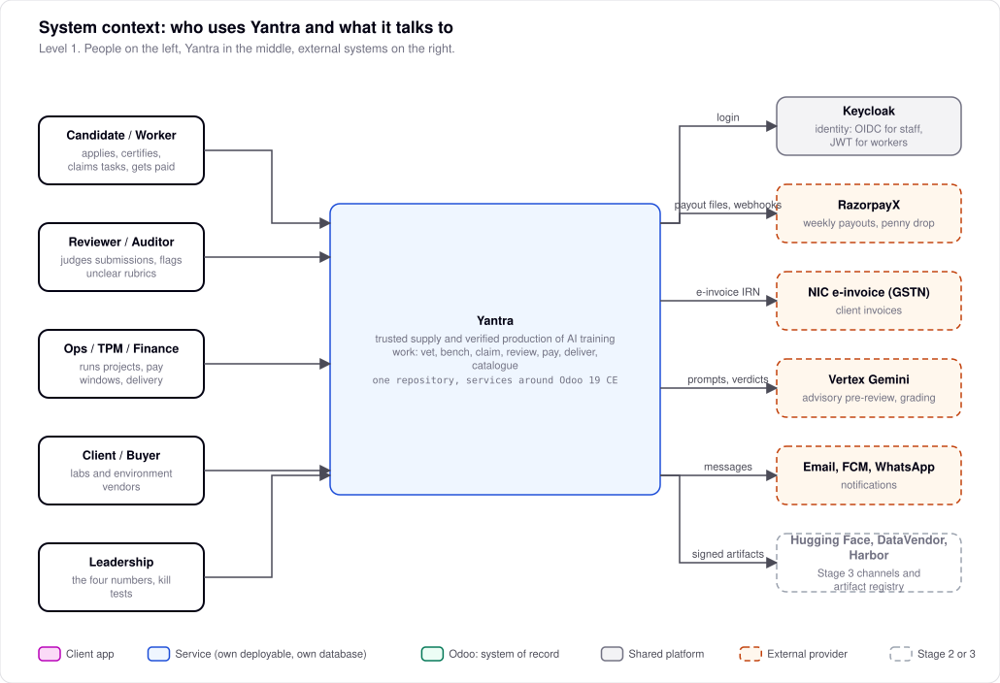
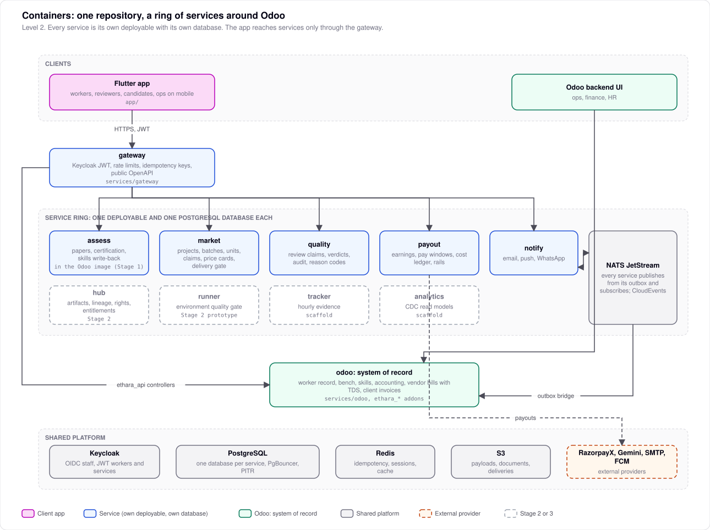
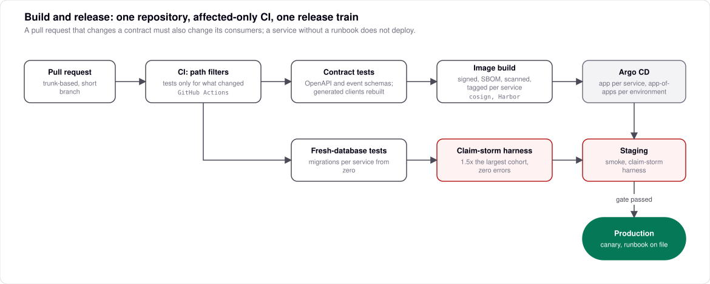
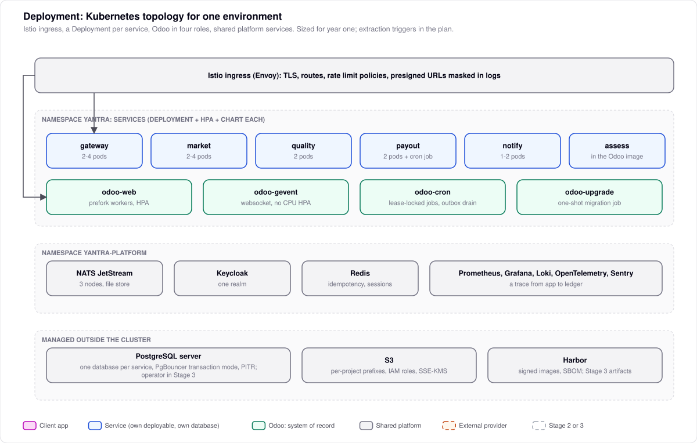
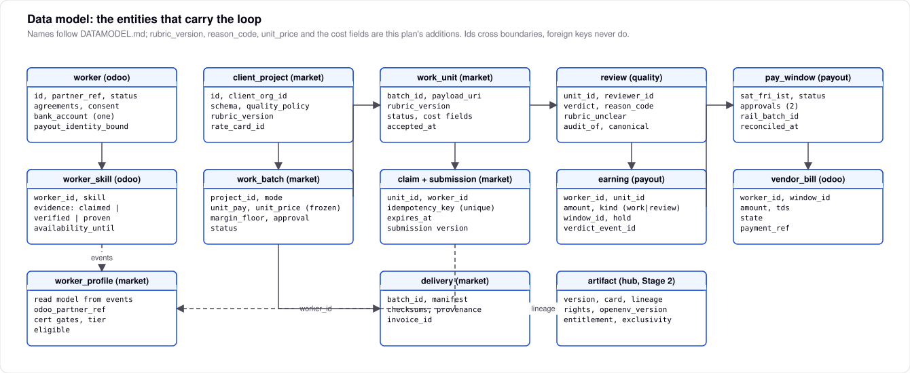
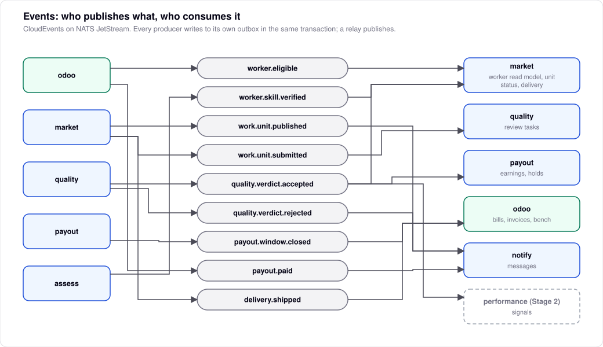
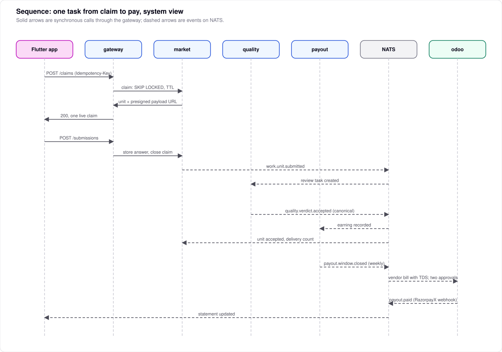

# Yantra system design

The design behind the unified plan: one repository, a ring of services around Odoo 19 Community Edition, a Flutter app, Keycloak, NATS. The repository documents (`ARCHITECTURE.md`, `INFRASTRUCTURE.md`, `DATAMODEL.md`, `MODULES.md`) are the point of truth; sections 3 and 4 mark the two proposals this design adds (one repository instead of submodules; `hub` and `runner` as services). Every diagram can be edited in draw.io.

## Contents

1. Goals and constraints
2. Context
3. Containers: the ring of services
4. Repository, build and release
5. Runtime topology and sizing
6. Data model and ownership
7. Events
8. Key sequences
9. API surface
10. Security and privacy
11. Scalability and performance
12. Reliability, operations, observability
13. Non-functional requirements
14. Open decisions

---

## 1. Goals and constraints

| Goal | Measure |
|---|---|
| Run the closed loop with real money in twelve weeks: vet, onboard, claim, review, pay, deliver, invoice | the Stage 1 gates in the plan |
| Isolate the hot path (claims and submissions) from the system of record | the claim path never touches an Odoo table; p99 claim under 500 ms at 500 concurrent workers |
| Make every money movement reconstructable | zero double claims; zero double pay; reconciliation to the paisa nightly |
| Keep the repository's architecture | same services, same integration rules, same identity and bus |
| Fit a squad of five to seven | shared code in one package; one CI; one release train |

Constraints: Odoo 19 Community Edition only (no Enterprise code); Indian entity (Razorpay rails, TDS, GST, DPDP); existing Flutter assessment app and Keycloak; year-one envelope of 3,000 registered and 500 concurrent workers inside the repository's 200K ceiling.

---

## 2. Context



| Actor | Through | Needs |
|---|---|---|
| Candidate and worker | Flutter app | apply, certify, onboard, claim, work, submit, see earnings and statements |
| Reviewer and auditor | Flutter app | claim the next submission, judge with the rubric version, give reason codes, audit samples |
| Ops, TPM, finance | Odoo backend UI and app | projects, batches, the bench, pay windows, deliveries, invoices, margin |
| Client and buyer | manifest and invoice; Stage 2 console | deliveries, acceptance, quality, feedback |
| Leadership | the four numbers | continue, change course, stop |

External systems: Keycloak (identity), RazorpayX (payouts), NIC e-invoice (GST), Vertex Gemini (advisory AI), email, FCM and WhatsApp (messages), Harbor and the public hubs (Stage 3 artifacts).

---

## 3. Containers: the ring of services



| Container | Owns | Stage 1 state | Later |
|---|---|---|---|
| `app` (Flutter) | every worker, reviewer and candidate journey; ops on mobile; gateway-only networking | web | mobile build with FCM in Stage 2 |
| `gateway` | Keycloak JWT validation; per-worker rate limits (429 with Retry-After); idempotency keys for every mutation with a Redis dedup table and a unique-constraint fallback; retry absorption; the public OpenAPI document | built in full | buyer Organizations and step-up for the client console |
| `assess` | papers generated from the project SOP; proctored sittings; certification tag and retake policy; outcome events; skills write-back with evidence level | the Assessment v2 engine behind its own contract and route; runtime inside the Odoo image (**proposal**, the one exception to a service per deployable) | own deployable in Stage 2; credential checks against issuers; AI interviews in Stage 3 |
| `market` | client projects, batches, work units, claims with `SKIP LOCKED` and TTL, submissions, import with dry run, price card with `unit_price` frozen at publish, assigned mode, rubric version on every unit, delivery gate and manifest, the worker read model | built in full | quote engine with tiers; agentic unit types in Stage 2; authoring tasks in Stage 3 |
| `quality` | review claims (never own work), single review plus a 10% audit sample, the canonical verdict, reason codes, the "rubric unclear" flag, billable client rework, review earnings | built in full | calibration, seeded gold, advisory LLM pre-review, disputes, trust per domain in Stage 2; the runner verdict as a stage in Stage 3 |
| `payout` | earnings on the accept event, weekly window (Saturday to Friday IST), holds, cost ledger per unit (pay, review, audit, rail fee, levy), statements; rail adapters (RazorpayX, bank file) | built in full; vendor bills and reconciliation through Odoo | a second rail or country |
| `notify` | the only holder of messaging credentials; templates; delivery log | email | FCM and WhatsApp with mobile |
| `odoo` | the system of record: worker record, agreements, DPDP consent, documents, the bench (skills with evidence level, availability stale after 14 days, past quality), accounting, self-billed vendor bills with TDS, client invoices, margin report; `ethara_workforce`, `ethara_api`, accounting glue | a separate `yantra` deployment of the existing image | OCA `queue_job`, `sign_oca`, `fs_attachment` after the licence audit |
| `hub` (**proposal**) | datasets, environments and models as versioned entries with cards, lineage to units and people, a rights field enforced in queries, delivery mappings, entitlements with an exclusivity class, signed OCI delivery, OpenEnv conformance | not built | internal catalogue in Stage 2; storefront and entitlements in Stage 3 |
| `runner` (**proposal**) | the environment quality gate: deterministic replay, pass-rate band against a reference panel, reward-hackability audit; sandboxed execution | not built | standalone prototype in Stage 2; production in Stage 3 |
| `tracker` | activity ingestion, screenshots to S3, caps, anomaly flags | scaffold (chart and health endpoint) | only if a client insists on hourly pay |
| `analytics` | CDC read models, BI | scaffold | Stage 3 |

Shared platform: Keycloak, NATS JetStream, PostgreSQL (one database per service), Redis, S3, Istio, observability.

### Integration rules

| Pattern | Rule |
|---|---|
| Worker mutation | app → gateway (idempotency key) → service database → outbox → NATS → Odoo ledger; never a synchronous write from the app into Odoo tables |
| Events out of Odoo | `ethara.outbox` rows written by `ethara_*` models, drained by a lease-locked cron into NATS; no broker client inside the Odoo process |
| Calls into Odoo | native `@http.route` controllers in `ethara_api` secured by Keycloak JWT; no in-Odoo REST framework; XML-RPC forbidden for new work |
| Data ownership | Odoo owns people, finance and project entities; each service owns its bounded context and syncs master data from events; a service never writes another's tables |
| Hot paths | the claim path writes only unit and claim rows; no counters on worker or batch rows; no chatter per claim; task lists show no counts |
| Contention | retries with backoff on Odoo lock errors; hot rows live in service databases |
| Money | the `quality.verdict.accepted` event is the only trigger for an earning in `payout` and a bill in `odoo`; nightly reconciliation alerts and never auto-adjusts |

---

## 4. Repository, build and release

**Proposal:** fold the eleven submodules (app, nine services, deployment) into the hub repository as directories. Service names, the database-per-service rule and the charts are unchanged.

```
yantra/
  app/                    Flutter
  services/
    gateway/  assess/  market/  quality/  payout/  notify/  odoo/
    hub/  runner/         Stage 2 and 3
    tracker/  analytics/  scaffolds until their trigger
  packages/
    contracts/            OpenAPI per service, CloudEvents schemas, generated Dart and Python clients
    py-common/            auth, tracing, outbox publisher, idempotency, config, test fixtures
  deployment/
    charts/<service>/     one Helm chart per deployable
    argocd/  policies/  terraform/
  tools/                  claim-storm harness, fixtures, data generators
  docs/                   plans, ADRs, runbooks
```

| Rule | Meaning |
|---|---|
| A service imports only `packages/*` | never another service's code; ids cross boundaries, foreign keys never do |
| Database per service | each service owns its schema and migrations; no cross-database joins; read models from events |
| Sync through the gateway contract, async through the bus | no service calls another's database or internal URL |
| Transactional outbox everywhere | the change and its event in one transaction; a relay publishes; consumers are idempotent |
| A contract change and all its consumers in one pull request | generated clients rebuilt in CI; a stale consumer fails the build |
| Affected-only CI, one release train | path filters; contract tests; fresh-database tests per service; every image signed, with an SBOM, tagged per service |
| Four things per service | Dockerfile, Helm chart, migrations, runbook; no runbook, no production |
| Decisions written down | an ADR in `docs/adr` for anything that constrains more than one service |



Environments: staging and production, each an Argo CD app-of-apps. Promotion is a pull request that bumps image tags; the staging gate runs smoke tests and the claim-storm harness at 1.5x the largest cohort.

---

## 5. Runtime topology and sizing



| Component | Year-one shape | Notes |
|---|---|---|
| Istio ingress | TLS, routes, rate-limit policies, presigned URLs masked in access logs | already deployed |
| Services | a Deployment with HPA per service; gateway and market 2 to 4 pods; quality, payout, notify 1 to 2; payout also a cron job for the window | one chart each |
| Odoo | four roles: `odoo-web` (prefork workers, HPA), `odoo-gevent` (websocket, no CPU HPA), `odoo-cron` (lease-locked jobs, outbox drain), `odoo-upgrade` (one-shot migration job before rollout) | per `INFRASTRUCTURE.md` |
| NATS JetStream | 3 nodes, file store, one stream per domain | |
| Keycloak | one realm; staff OIDC into Odoo; worker and service JWTs | built |
| Redis | idempotency, sessions, cache | small instance |
| PostgreSQL | a dedicated server, one database per service plus Odoo's, PgBouncer in transaction mode, PITR; connection budget per chart; alert at 85% | an operator (Crunchy or Percona) in Stage 3 when a platform owner exists |
| S3 | per-project prefixes, IAM roles, SSE-KMS, lifecycle rules | |
| Harbor | signed images and SBOMs; Stage 3 artifacts | |
| Observability | Prometheus, Grafana, Loki, OpenTelemetry traces across gateway and ring, Sentry | one trace from app to ledger |

| Quantity | Year-one assumption | Design response |
|---|---|---|
| Registered workers | 1,000 to 3,000 | worker rows off the hot path; read model in `market` |
| Concurrent active workers | 300 to 500 | claim = one short transaction |
| Peak claims per second | 5 to 20 | indexed available set; `SKIP LOCKED`; p99 under 500 ms |
| Units per batch | 1,000 to 20,000 | background import; paginated views; chunked export |
| Reviews per day | 5,000 to 20,000 | bounded JSON answers; artifacts in S3 |
| Pay window | weekly, 1,000 to 3,000 workers | chunked job under a lease; vendor bills in chunks of 200 |
| Database connections | reserved pool per service; Odoo web 4 pods × 4 workers × 2 | `db_maxconn <= max_client_conn <= max_connections`; alert at 85% |

---

## 6. Data model and ownership



Names follow `DATAMODEL.md`. This plan adds four things to the market and quality stores: `rubric_version` on every unit and verdict, `reason_code` on every rejection, `unit_price` frozen next to `unit_pay` on the batch, and cost fields on the unit.

| Store | Key tables | Owner | Notes |
|---|---|---|---|
| `odoo` | `res.partner` and `ethara_workforce.worker` (worker record, agreements, consent, documents, bank account, payout identity bound), `worker_skill` (skill, evidence level, availability), `account.move` (vendor bills with TDS, client invoices), `ethara.outbox` | odoo | the bench is a view over worker and skill; PII fields finance-only |
| `market_db` | `worker_profile` (read model from events: partner ref, cert gates, tier, eligible), `client_org`, `client_project` (schema, quality policy, rubric version, rate card), `rate_card` and `rate_tier`, `work_batch` (mode, frozen pay and price, margin floor, approval), `work_unit` (payload URI, rubric version, status, cost fields), `claim` (idempotency key unique, expires), `submission` (version per claim), `unit_event`, `delivery` (manifest, checksums, provenance, invoice id) | market | the claim path touches only `work_unit` and `claim` |
| `quality_db` | `review_task`, `review` (verdict, reason code, rubric unclear, audit-of, canonical), calibration and seed tables (Stage 2), `dispute` (Stage 2) | quality | one canonical verdict per unit |
| `payout_db` | `earning` (worker, unit, amount, kind, window, hold, verdict event id), `pay_window` (Saturday to Friday IST, approvals, rail batch, reconciled at), `rail_event`, `cost_ledger` | payout | append-only money tables; numeric(18,6) with currency |
| `assess_db` | papers, sittings, scores, certifications | assess | inside the Odoo image in Stage 1 |
| `notify_db` | templates, deliveries, devices | notify | credentials only here |
| `hub_db` (Stage 2) | `artifact` (version, card, lineage, rights, OpenEnv version), `entitlement` (exclusivity class) | hub | rights enforced in every query |

Invariants:

- One live claim per worker; one claim per unit at a time (unique index); a retried claim returns the first claim.
- One canonical verdict per unit; the reviewer is never the author; audit samples precede canonical status.
- One earning per accepted unit and one per review, each referencing its verdict event id; no earning without a verdict.
- `unit_pay` and `unit_price` are frozen at publish; a batch below its margin floor cannot publish without a recorded approval.
- Earnings = bills = payouts net + TDS for every closed window, to the paisa.
- Every unit and verdict records the rubric version; every rejection records a reason code.

---

## 7. Events



CloudEvents on NATS JetStream. Each producer writes the event to its own outbox in the same transaction as the change; a relay publishes; consumers are idempotent on the event id.

| Subject | Producer | Consumers | Payload (key fields) |
|---|---|---|---|
| `worker.eligible` | odoo | market (worker read model), notify | worker id, partner ref, cert gates, timestamp |
| `worker.skill.verified` | assess | odoo (skills), market | worker id, skill, evidence level, paper id, score |
| `work.unit.published` | market | notify | batch id, unit count, pay, price, mode |
| `work.unit.submitted` | market | quality (review task) | unit id, claim id, submission version, rubric version |
| `quality.verdict.accepted` | quality | payout (earning), market (unit status, delivery count), performance (Stage 2) | unit id, reviewer id, rubric version, canonical, event id |
| `quality.verdict.rejected` | quality | market (unit back to pool or needs edits), notify | unit id, reason code, billable |
| `payout.window.closed` | payout | odoo (vendor bills with TDS) | window id, per-worker totals, holds |
| `payout.paid` | odoo | payout (statements), notify | window id, worker id, amount, rail reference |
| `delivery.shipped` | market | odoo (client invoice), hub (Stage 2 lineage) | batch id, manifest URI, accepted count |

Retention: streams keep 30 days; read models can be rebuilt by replay. A consumer that is down accumulates a backlog and an alert, never lost events.

---

## 8. Key sequences



The other sequences are in [User flows](03-user-flows.md): the worker from first contact to first payout, the reviewer, ops and the client from brief to invoice, finance's weekly pay window, and the Stage 3 factory.

---

## 9. API surface

The gateway owns the public OpenAPI document. Every mutation carries an `Idempotency-Key`. Every route answers `429` with `Retry-After` when limited. Envelope: `{"ok": true, "data": ...}` or `{"ok": false, "error": {"code", "message"}}`.

| Route | Auth | Idempotent on | Service |
|---|---|---|---|
| `POST /v1/apply` | public, rate-limited | email | odoo via `ethara_api` |
| `/v1/assess/*` (papers, sittings) | candidate token | per step | assess |
| `GET /v1/me` | worker | n/a | odoo |
| `POST /v1/onboarding/{profile, documents/presign, documents/confirm, agreement/accept, bank}` | worker | per step | odoo |
| `GET /v1/units/available` | worker | n/a | market (filtered by the worker read model) |
| `POST /v1/units/claim` | worker | `Idempotency-Key` | market |
| `GET /v1/units/{id}` | worker, live claim owner | n/a | market (presigned GET, five minutes) |
| `POST /v1/units/{id}/{save, submit, skip}` | worker, owner | `(claim_id, version_no)` | market |
| `POST /v1/units/{id}/rubric-unclear` | worker or reviewer | by unit | quality |
| `GET /v1/history`, `GET /v1/earnings`, `GET /v1/earnings/{window}/statement` | worker | n/a | payout |
| `POST /v1/review/next`, `POST /v1/review/{id}/{save, submit, release}` | reviewer | `(submission_id, stage)` | quality |
| `POST /v1/disputes` (Stage 2) | worker | by unit | quality |
| `POST /webhooks/razorpayx` | HMAC and replay window | rail event id | payout |
| `POST /v1/devices` (Stage 2) | worker | device | notify |
| Odoo backend models and views | internal users by group | ORM | ops, finance, HR |

Request logs carry `request_id`, `worker_id`, `unit_id`, `batch_id`, never tokens, payload bytes or bank details. Worker tokens expire within 24 hours.

---

## 10. Security and privacy

| Area | Design |
|---|---|
| Identity and roles | Keycloak roles for worker, reviewer, ops, finance, admin; workers and reviewers never reach the Odoo backend; record rules `user_id = user.id` on every worker-visible model, penetration-tested each quarter; reviewers see submissions only through a review claim; TOTP for ops and finance |
| Client data | per-project S3 prefix and IAM policy; presigned GET of five minutes; URIs, not bytes, in services and Odoo; workers see only the claimed unit, never file names or other workers; paste and drag disabled per batch; append-only event trail; retention purge per project; presigned URLs masked in Istio logs |
| Worker PII | PAN and bank details on finance-only fields; documents in per-worker prefixes with SSE-KMS; DPDP consent with version and timestamp; erasure job after statutory retention; identity bound to the payout account; step-up authentication on bank changes; 72-hour hold after account recovery |
| Money | two-person approval on payout batches; one bank account per worker; penny-drop verification; webhook HMAC and replay window; rail idempotency keys; per-window caps; 7-day first hold; nightly reconciliation alert |
| Supply chain | slim, non-root, hash-pinned signed images with SBOM and scans; Kyverno blocks unsigned images; no third-party LLM proxy; egress allow-list (Vertex, S3, RazorpayX, SMTP, client buckets); External Secrets for every credential |
| LLM safety | task content is untrusted input to any model; no PII in prompts; model verdicts are advisory, never canonical alone; quotas and daily caps |
| Attestation | SOC 2 Type 2 window opened in Stage 0; evidence collected from day one |

---

## 11. Scalability and performance

Year one is sized for 3,000 registered and 500 concurrent workers; the repository's 200K envelope stays the design ceiling and the Phase 5 load test stays the ceiling check.

| Trigger | Response |
|---|---|
| p99 claim over 1 s at the load target | shard the available set by batch; move the worker read model to Redis |
| more than about 3,000 concurrently active workers | a second `market` replica set per region; partition `work_unit` by batch |
| review contention with claims | separate review read models; move audit sampling to a worker process |
| a second payout rail or country | a rail adapter per country in `payout`; a second legal entity |
| data beyond what Odoo reports and the Performance views serve | CDC into `analytics` |
| HA beyond a managed server | a Postgres operator (Crunchy or Percona) |

Hot-path rules: the claim path writes only unit and claim rows; no counters on worker or batch rows; no chatter per claim; task lists show no counts.

---

## 12. Reliability, operations, observability

| Concern | Design |
|---|---|
| Deploys | Argo CD; one-shot migration job per service before rollout; a deploy gate on contract versions; readiness checks; no deploy inside an active batch deadline or exam sitting |
| Jobs | every scheduled job under a lease row, tick-limited and idempotent; `CRON_LEASE_BLOCKED` alerts |
| Backups | daily snapshots and PITR on the dedicated server; a quarterly restore drill |
| Runbooks | stuck claims; stalled pay window; failed webhook; rail outage (fall back to the bank file); NATS backlog; S3 CORS failure; connection headroom before a large batch |
| On-call | a rota from the delivery step; alerts route to the service owner by role |

| Signal | Alert |
|---|---|
| claim latency p99; claims per second | p99 over 1 s for 5 minutes |
| units with two live claims (must be zero) | any |
| queue depth and age: available, submitted, in review, needs edits | review backlog age over 48 hours |
| pay window reconciliation delta; failed payouts; webhook failures | any delta; over 1% failed |
| NATS consumer lag per stream | lag over 5 minutes |
| Postgres connections per database; PgBouncer waiting clients | over 85% of slots; waiting over 1 minute |
| 5xx on `/v1/*` | over 1% over 2 minutes |
| cron lease blocked; job duration | blocked twice in a row |
| login failures per minute; token issuance | spike |

---

## 13. Non-functional requirements

| Area | Requirement | Target | Proof |
|---|---|---|---|
| Performance | claim latency | p99 under 500 ms at 500 concurrent simulated workers on a 2,000-unit batch | market core gate |
| | task fetch; review next | p95 under 800 ms; p99 under 500 ms | market core gate |
| | app first load | under 3 s on a low-end laptop over 4G | market core gate |
| | pay window close; export | under 30 minutes for 3,000 workers; 20,000 units in under 10 minutes | money and delivery gates |
| Availability | worker, reviewer and exam routes | 99.5% monthly; no deploy inside an active batch deadline or sitting | pilot gate |
| | payout job | idempotent and rerunnable | money gate |
| | recovery | RPO 15 minutes (PITR), RTO 2 hours | foundations drill |
| Scalability | year-one envelope and triggers | 3,000 registered, 500 concurrent, 20 claims per second; triggers in section 11 | harness at 1.5x |
| Correctness | double claims; double pay; reconciliation; money types | 0; 0; to the paisa nightly; numeric(18,6) with currency | market core and money gates |
| Security | identity, secrets, supply chain, network, testing | least-privilege roles and tested record rules; no secrets in a database or image; signed images with SBOM; egress allow-list; webhook HMAC; quarterly penetration test | foundations to money |
| Privacy (DPDP) | consent, minimisation, retention, breach, roles | purpose-specific consent with version; finance-only PII; erasure within 30 days; 72-hour notification path; role per client contract | identity to pilot |
| Compliance | TDS, GST, records | CA-validated TDS fixtures; export invoices under LUT; IRN for Indian clients; books retained at least 8 years; append-only money tables | money and delivery |
| Auditability | trail | every transition and money movement reconstructable with actor and timestamp | market core and money |
| Maintainability | boundaries, tests, migrations | a service imports only `packages/*`; fresh-database CI per service; changed-line coverage at least 97%; expand and contract migrations; contract-version gate | CI |
| Observability | metrics, logs, traces | section 12 signals; ids in logs, never secrets; one trace from app to ledger | foundations to pilot |
| Usability | app | keyboard-navigable; 1366×768; Hindi and English strings externalised (Stage 2) | market core |
| Cost | infrastructure and LLM | no new platform before a trigger; small Redis; S3 lifecycle; LLM spend capped per paper and per batch | pilot |

---

## 14. Open decisions

| Decision | Options | Default | When |
|---|---|---|---|
| Postgres operator | Crunchy, Percona | none in year one; decide when a platform owner exists | Stage 3 |
| When `assess` leaves the Odoo image | after the first paying pilot; later | Stage 2, after the pilot | Stage 2 planning |
| Pricing method | fixed rate per project; quote engine with tiers | fixed now, tiers in Stage 2 | first paying pilot |
| First factory vertical | ERP replicas; Indian finance and tax; medicine or law; Indic language | after the Stage 0 interviews | Stage 0 |
| Trust score scope | per domain; global | per domain | Stage 2 |
| Time-tracker client | build; integrate a vendor | neither until a client insists on hourly | on demand |
| Code-assessment sandbox | self-hosted; SaaS | per `ROADMAP.md` Phase 4 | Stage 2 |
