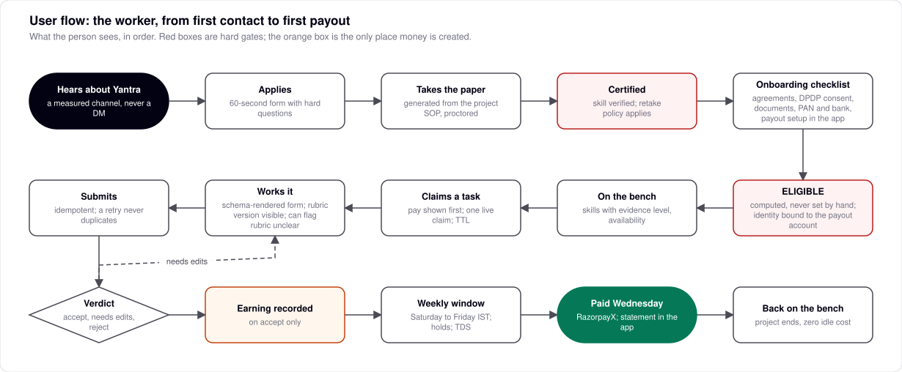
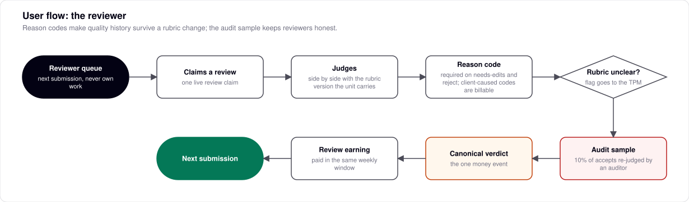
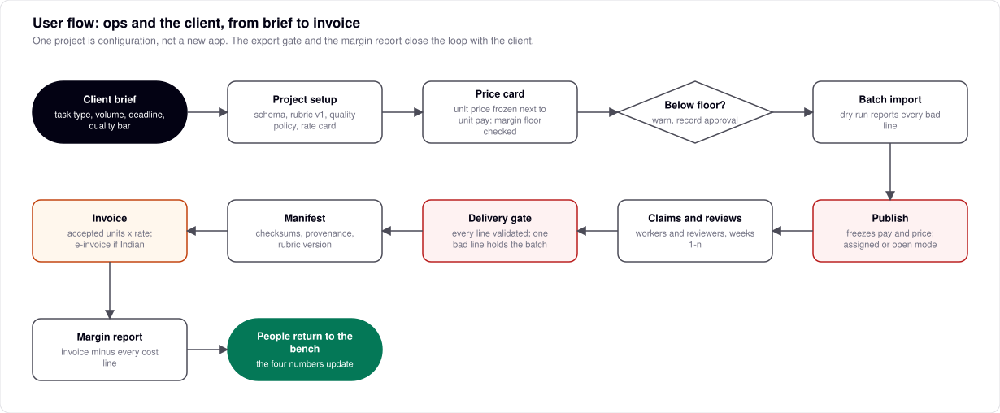
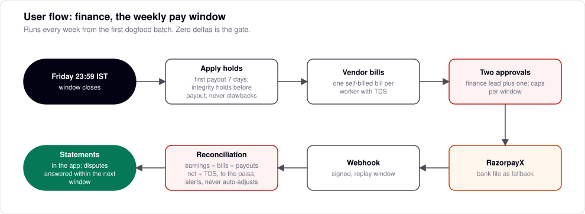
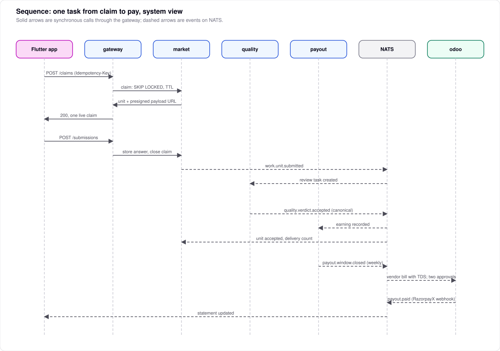
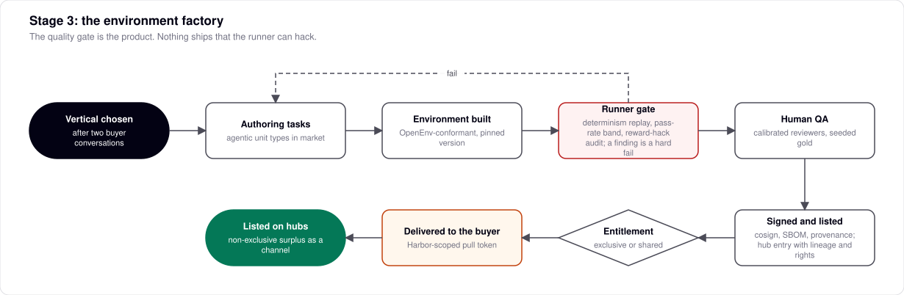

# User flows

One flow per person. Each has a diagram (editable in draw.io), a step table that says what the person sees and what the system does, and the edge cases that must be handled. Figures are examples.

## Contents

1. The worker: from first contact to first payout
2. The reviewer
3. Ops and the client: from brief to invoice
4. Finance: the weekly pay window
5. One task, system view (claim to pay)
6. Stage 3: the environment factory

---

## 1. The worker: from first contact to first payout

| # | Step | The person sees | The system does | Owner |
|---|---|---|---|---|
| 1 | Hears about Yantra | a post about the work on a measured channel; never a direct message | records the channel on the application | talent (Stage 2); manual in Stage 1 |
| 2 | Applies | a 60-second form with a few hard questions (language, sample task, availability) | creates the candidate; screens duplicates | odoo |
| 3 | Takes the paper | an assessment generated from the project's SOP, proctored | runs the sitting; scores; emits `worker.skill.verified` with the evidence level *verified* | assess |
| 4 | Certified | pass or fail with the retake policy | sets the certification tag that opens a category of work | assess |
| 5 | Onboarding checklist | six items: agreement, DPDP consent, identity documents, PAN, bank account (penny-drop verified), payout setup | stores each item; binds identity to the payout account; nothing is editable by hand | odoo |
| 6 | ELIGIBLE | a green state and the bench entry | computes ELIGIBLE from the six items; emits `worker.eligible`; market builds its worker read model | odoo, market |
| 7 | On the bench | skills with evidence level, availability date, past quality | availability goes stale after 14 days and reads as unknown | odoo |
| 8 | Claims a task | the batch with pay per unit shown before the claim; one live claim; a countdown | claim in one transaction with `SKIP LOCKED`; TTL; idempotency key; the worker read model decides eligibility | gateway, market |
| 9 | Works it | the form rendered from the batch schema; the rubric version; a "rubric unclear" action; the payload from a five-minute presigned link | serves the payload URL; no bytes pass through the services | market, S3 |
| 10 | Submits | a confirmation; a retry shows the same submission | stores the answer; closes the claim; emits `work.unit.submitted` | market |
| 11 | Verdict | accept, needs edits (with a reason), or reject (with a reason) | review claimed by someone else; audit sample; canonical verdict emitted | quality |
| 12 | Earning recorded | the unit in "accepted, payable" | one earning per accepted unit, referencing the verdict event | payout |
| 13 | Weekly window | the week's total, holds, TDS shown | window closes Friday 23:59 IST; holds applied | payout |
| 14 | Paid | the statement; every line clicks through to its unit | vendor bill with TDS in Odoo; two approvals; RazorpayX; webhook; reconciliation | odoo, payout |
| 15 | Back on the bench | availability prompt when the batch ends | project end returns the person to the bench at zero idle cost | odoo |

Edge cases: a claim that expires returns the unit to the pool and tells the worker; a network retry of claim or submit returns the first result; a worker who changes bank details gets step-up authentication and a 72-hour hold after any account recovery; a worker cannot see any other worker's data (record rules tested with penetration tests).

---

## 2. The reviewer

| # | Step | The person sees | The system does |
|---|---|---|---|
| 1 | Queue | "next submission", never their own work, with the queue age | review claim, one live at a time |
| 2 | Judges | the payload and the answer side by side; the rubric version the unit carries | serves both from presigned links |
| 3 | Reason code | required on needs-edits and reject; client-caused codes marked billable | validates the code; records the verdict with the rubric version |
| 4 | Rubric unclear? | a flag with a note | routes to the TPM; answered within two days; a new rubric version may follow |
| 5 | Audit sample | 10% of accepts go to an auditor before they become canonical | the auditor's verdict wins; disagreements feed calibration (Stage 2) |
| 6 | Canonical verdict | the unit leaves the queue | emits `quality.verdict.accepted` or `.rejected`; the only money event |
| 7 | Review earning | the review pay in this week's statement | one earning per review |

Edge cases: a reviewer who is also a worker never draws their own submissions; a reviewer who releases a claim returns it to the queue; model pre-review (Stage 2) is advisory and never canonical alone; a dispute (Stage 2) reverses a rejection as an adjustment line, never by editing history.

---

## 3. Ops and the client: from brief to invoice

| # | Step | Ops sees | The system does |
|---|---|---|---|
| 1 | Client brief | task type, volume, deadline, quality bar | creates the project shell |
| 2 | Project setup | schema (form fields), rubric v1, quality policy, rate card | stores the configuration; a new project type stands up in under a week |
| 3 | Price card | unit price next to unit pay; expected cost per unit; expected margin | computes expected cost from the rate card, review, audit, rail and levy lines |
| 4 | Below floor? | a warning and an approval field | a batch under the floor cannot publish without a recorded approval |
| 5 | Batch import | the dry-run report: every bad line with the reason | validates each line against the schema; nothing is written on a failed dry run |
| 6 | Publish | the frozen pay and price; open or assigned mode | freezes `unit_pay` and `unit_price`; emits `work.unit.published` |
| 7 | Claims and reviews | the queue: available, claimed, submitted, in review, needs edits; stuck claims | releases expired claims; alerts on backlog age over 48 hours |
| 8 | Delivery gate | the validation report; one bad line holds the batch | validates every accepted unit against the schema |
| 9 | Manifest | counts, checksums, provenance, rubric versions | writes the manifest; emits `delivery.shipped` |
| 10 | Invoice | accepted units × price (+ billable rework); e-invoice IRN for Indian clients | raises the client invoice in Odoo |
| 11 | Margin report | invoice minus every cost line, per batch and project | reads the cost ledger per unit |
| 12 | People return to the bench | the four numbers updated | closes the project; availability prompts go out |

Edge cases: a client changing the glossary mid-batch produces a new rubric version and client-caused reason codes (billable); a retention purge runs per project after the agreed days; the client never gets a login in Stage 1 (manifest, invoice and a weekly report); the Stage 2 console adds live acceptance and quality reports.

---

## 4. Finance: the weekly pay window

| # | Step | Finance sees | The system does |
|---|---|---|---|
| 1 | Window closes | Friday 23:59 IST; the week's earnings total | freezes the window |
| 2 | Holds | first-payout 7-day hold; integrity holds (duplicate account, device, bank mismatch) | holds happen before payout, never as clawbacks after |
| 3 | Vendor bills | one self-billed bill per worker with TDS computed | Odoo raises the bills from `payout.window.closed` |
| 4 | Two approvals | the batch total, caps per window | the finance lead plus one approver; no single-person release |
| 5 | Rail | RazorpayX payout file; bank file as fallback | idempotent rail calls; per-window caps |
| 6 | Webhook | paid, failed, returned | signed webhook with a replay window; `payout.paid` |
| 7 | Reconciliation | earnings = bills = payouts net + TDS, to the paisa; any delta as an alert | nightly; alerts and never auto-adjusts |
| 8 | Statements | per worker, in the app; disputes answered within the next window | statements only after reconciliation |

Edge cases: a failed payout stays in the window with its reason and retries next window; a rail outage falls back to the bank file with the same bill numbers; TDS section and the LUT for export invoices are confirmed by the chartered accountant in Stage 0.

---

## 5. One task, system view (claim to pay)

Solid arrows are synchronous calls through the gateway. Dashed arrows are events on NATS. The only place money is created is the `quality.verdict.accepted` event consumed by `payout`; the only place money leaves is the vendor bill approved in Odoo.

---

## 6. Stage 3: the environment factory

| # | Step | Who | What happens |
|---|---|---|---|
| 1 | Vertical chosen | leadership, after two buyer conversations | one of: Odoo-based ERP replicas, Indian finance and tax workflows, credentialed medicine or law, Indic language |
| 2 | Authoring tasks | bench workers with the right certification | agentic unit types in `market`: trajectory, rubric, pairwise, grader check |
| 3 | Environment built | engineers and authors | OpenEnv-conformant, pinned version, provenance recorded (contributor ids, IP assignment, OSS manifest) |
| 4 | Runner gate | `runner` | deterministic replay, pass-rate band against a reference panel, reward-hackability audit; a finding is a hard fail and goes back to authoring |
| 5 | Human QA | calibrated reviewers | seeded gold; the usual review path |
| 6 | Signed and listed | `hub` | cosign signature, SBOM, Harbor image; a hub entry with lineage and the rights field |
| 7 | Entitlement | sales, `hub` | exclusive (single member; other listings withdrawn) or shared |
| 8 | Delivered | buyer | a scoped pull token from Harbor; canary seeds detect leaks |
| 9 | Listed on hubs | `hub` | non-exclusive surplus on Hugging Face or DataVendor as a channel |

Edge cases: an environment that escapes the gate after shipping is a severity-one defect; the OpenEnv version is pinned per artifact so a standard change does not break a delivered environment; nothing produced under a client contract is listed.
