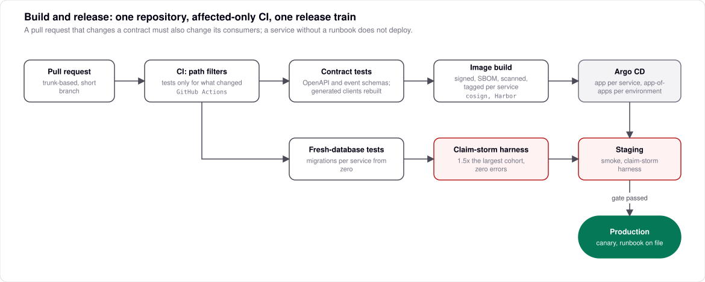

# Tech stack

Every technology in Yantra, what it does here, why it was chosen, and what was not chosen. The repository (`ARCHITECTURE.md`, `INFRASTRUCTURE.md`, `MODULES.md`) is the point of truth; rows marked **proposal** differ from it.

## 1. At a glance

| Layer | Choice |
|---|---|
| System of record | Odoo 19 Community Edition, OCA modules, `ethara_*` addons |
| Services | Python 3.12, FastAPI, SQLAlchemy, Alembic; one `uv` workspace |
| Client | Flutter, one codebase for web and mobile |
| Identity | Keycloak (OpenID Connect for staff, JWT for workers and services) |
| Events | NATS JetStream with CloudEvents envelopes; transactional outbox per service |
| Databases | PostgreSQL, one database per service, PgBouncer, point-in-time recovery |
| Cache | Redis |
| Files | S3-compatible object storage |
| Payments | Razorpay (RazorpayX payouts), bank file fallback |
| AI | Vertex Gemini through one client with a cost ledger |
| Runtime | Kubernetes, Istio ingress, Helm, Argo CD |
| Supply chain | Harbor, cosign, SBOM, Kyverno policies |
| CI | GitHub Actions with path filters |
| Observability | Prometheus, Grafana, Loki, OpenTelemetry, Sentry |
| Stage 3 | OpenEnv artifact contract, Harbor-signed OCI images, Hugging Face Hub for the free tier |

## 2. Application

| Technology | What it is | Role in Yantra | Why | Not chosen |
|---|---|---|---|---|
| **Odoo 19 CE** | open-source ERP in Python; Community Edition only, no Enterprise code | people, skills, agreements, consent, the bench, accounting, self-billed vendor bills with TDS, client invoices, GST e-invoicing, margin report | Ethara runs it today; India localisation in core; one ledger for staff and contractors; the licence posture in `MODULES.md` | a new ERP; a hand-built ledger; Odoo Enterprise |
| **OCA modules** | community add-ons for Odoo | `auth_oidc` (Keycloak login), `queue_job` (background jobs), `sign_oca` (e-signature), `fs_attachment` (S3 files), tier validation (approvals) | verified on the 19.0 branches; licence obligations recorded | in-house copies of the same features |
| **`ethara_*` addons** | Ethara's own Odoo modules | `ethara_workforce` (worker record, bench), `ethara_api` (controllers the gateway calls), accounting glue | the only custom code inside Odoo; everything else is a service | |
| **Python 3.12** | the service language | every service | one language with Odoo; the team's skill | Go, TypeScript services (a second toolchain for a small team) |
| **FastAPI** | web framework | HTTP APIs for every service; generated OpenAPI | typed, fast, standard; the OpenAPI document is the contract | Django REST, Flask |
| **SQLAlchemy, Alembic** | ORM and migrations | service data access; versioned schema per service | mature; migrations per service from zero in CI | raw SQL only; a shared schema |
| **`uv` workspace** | Python package and workspace manager | one lockfile for the repository; `packages/py-common` and `packages/contracts` shared | fast, reproducible, one command | pip-tools per service; Poetry |
| **`packages/contracts`** | OpenAPI documents, CloudEvents schemas, generated Dart and Python clients | the only way services and the app talk | a contract change and its consumers in one pull request; a stale client fails the build | copying types by hand |
| **`packages/py-common`** | shared library | auth, tracing, transactional outbox, idempotency, configuration, test fixtures | written once, not per service | each service re-implementing the outbox |
| **Flutter** | Google's UI toolkit | the worker, reviewer, onboarding and earnings app; ops on mobile | the assessment app already exists in Flutter with a design system, API client and proctoring; mobile from the same code | a second web stack (React) for workers |
| **Ethara portal design tokens** | the colour and type system of the assessment app | every screen and mockup | one look across the product | a new design system |

## 3. Platform

| Technology | What it is | Role in Yantra | Why | Not chosen |
|---|---|---|---|---|
| **Keycloak** | open-source identity and access server | single sign-in: staff into Odoo via OpenID Connect; JWTs for workers and service-to-service calls; one realm in Stage 1 | built; standard; buyer Organizations and step-up authentication later | Odoo users and home-made tokens; a hosted identity service |
| **NATS JetStream** | message bus with persistence and replay | carries every event between services and into Odoo; CloudEvents envelopes | light to run; replay for new read models; ratified in `ROADMAP.md` | Kafka (documented fallback if volume demands it); RabbitMQ |
| **Transactional outbox** | a pattern: write the event in the same database transaction as the change, relay it afterwards | every service and Odoo (`ethara.outbox` drained by a lease-locked cron) | at-least-once delivery without a broker client inside Odoo (forbidden by `ARCHITECTURE.md`) | publishing directly from request handlers |
| **PostgreSQL** | relational database | one database per service; Odoo's database; `SKIP LOCKED` on the claim path | the claim workload needs row locking; one engine for everything | a document store for units |
| **PgBouncer** | connection pooler | transaction-mode pooling in front of every database | the shared primary ran out of connections before [L]; a budget per chart with an alert at 85% | direct connections |
| **A dedicated Postgres server now; Crunchy or Percona operator in Stage 3** | managed server; Kubernetes operator with HA, backups, pooling | year one on a dedicated server with point-in-time recovery; an operator when a platform owner exists | the problem today is the shared primary, not HA | **proposal:** the repository puts the operator in Phase 0 |
| **Redis** | in-memory store | idempotency keys (with a unique-constraint fallback in Postgres), sessions, cache | standard; small | sessions in Postgres |
| **S3-compatible object storage** | file storage | task payloads, documents, deliveries, artifacts; per-project prefixes; IAM roles; SSE-KMS; presigned links of five minutes | bytes never cross a service or Odoo | files on pods |
| **Kubernetes** | container orchestration | every service and Odoo (four roles: web, websocket, cron, upgrade job) | already deployed | virtual machines per service |
| **Istio** | service mesh and Envoy-based ingress | TLS, routes, rate-limit policies, presigned URLs masked in logs | already running | a second ingress (Envoy Gateway, Contour) |
| **Helm** | Kubernetes packaging | one first-party chart per service | consistent with the service-per-deployable layout (`INFRASTRUCTURE.md`) | the deprecated Bitnami Odoo chart |
| **Argo CD** | GitOps delivery | an application per service, app-of-apps per environment; the cluster follows the repository | auditable deploys; rollbacks are a revert | hand-run `kubectl` |
| **Harbor, cosign, SBOM, Kyverno** | registry; image signing; software bill of materials; policy engine | every image signed and scanned; policies block unsigned images; Stage 3 artifacts signed the same way | supply-chain incidents at comparable platforms [R] | unsigned public images |
| **GitHub Actions** | CI | path filters (test only what changed), contract tests, fresh-database tests per service, image build, the claim-storm harness as a gate | lives with the repository | a separate CI server |
| **Prometheus, Grafana, Loki** | metrics, dashboards, logs | the alerts in the plan (claim p99, double claims, backlog age, reconciliation deltas, connection headroom) | already deployed | |
| **OpenTelemetry** | tracing | one trace from the app through the gateway and services to the ledger | a distributed system without traces cannot be operated | logs only |
| **Sentry** | error tracking | services and Odoo (OCA `sentry`) | already deployed | |
| **External Secrets** | secrets from a vault into Kubernetes | every credential; nothing in a database or an image | the breach vectors at incumbents were secrets and proxies [R] | secrets in environment files |

## 4. Money, AI and compliance

| Technology | What it is | Role in Yantra | Why | Not chosen |
|---|---|---|---|---|
| **Razorpay (RazorpayX)** | Indian payments provider; RazorpayX is its payout product | weekly payouts to worker bank accounts; penny-drop bank verification; signed webhooks | Ethara's existing provider; domestic rails; no foreign exchange | **proposal:** the repository lists Stripe Connect as primary; Connect transfers are not available to an Indian entity, so it waits for a non-Indian entity |
| **Bank file** | a payout file uploaded to the bank | fallback when the rail is down, same bill numbers | no window is ever stuck on a provider outage | |
| **NIC e-invoice (IRN)** | India's GST e-invoicing registry | client invoices for Indian clients; export invoices under LUT | legal requirement; in Odoo's India localisation | |
| **Vertex Gemini** | Google's hosted large language model | advisory pre-review in `quality`, grading help in `assess`; never the canonical verdict; task content treated as untrusted input; no PII in prompts | the existing client, quota guards and cost ledger; no third-party proxy in the data path | a proxy service in front of models |
| **OpenEnv** | an environment packaging standard | (Stage 3) every environment pinned to an OpenEnv version | what buyers already run | a house format |
| **Hugging Face Hub, DataVendor, Prime Intellect** | public artifact hubs and marketplaces | (Stage 3) channels for non-exclusive surplus; never the product | hubs exist; building one is the wrong use of the year | a Yantra marketplace |
| **SOC 2 Type 2** | an audited security attestation | the window opens in Stage 0; evidence collected from day one | the longest pole in any lab conversation | waiting until a lab asks |

## 5. Rules that bind the stack together

- A service imports only `packages/*`; ids cross boundaries, foreign keys never do.
- Synchronous calls go through the gateway contract; asynchronous through the bus; no service calls another's database or internal URL.
- Every state change others care about goes through the outbox; consumers are idempotent.
- Every service ships a Dockerfile, a Helm chart, migrations and a runbook; without a runbook it does not reach production.
- Every image is signed and carries an SBOM; every secret comes from the vault; egress is an allow-list.
- Every request is traceable from the app to the ledger; logs carry request, worker, unit and batch ids and never tokens, payload bytes or bank details.

