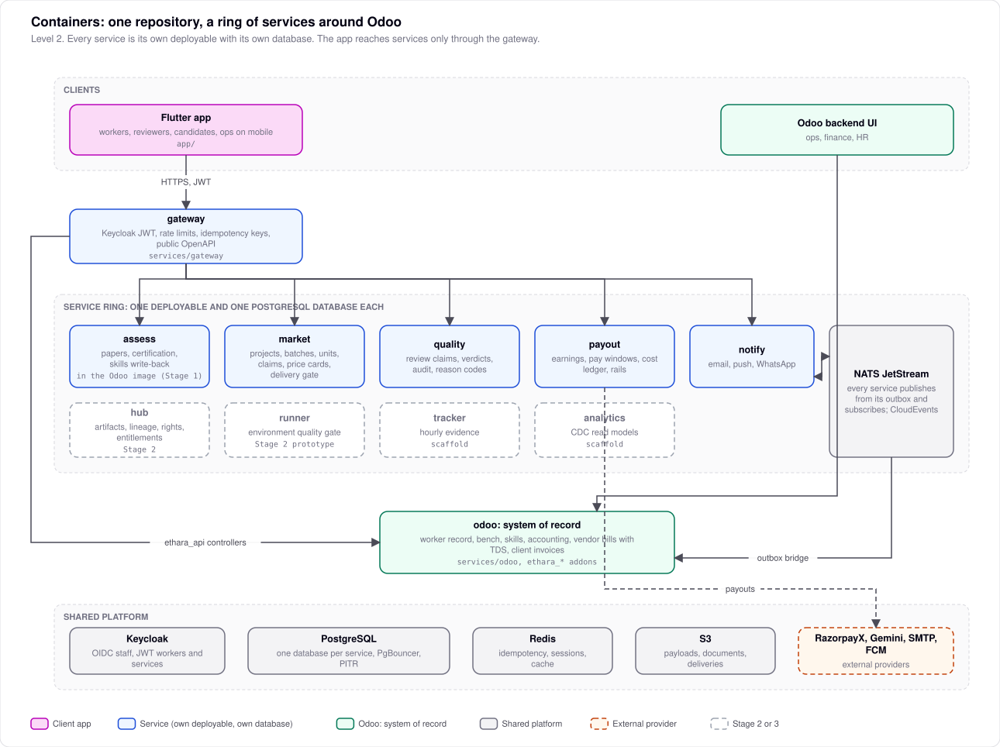
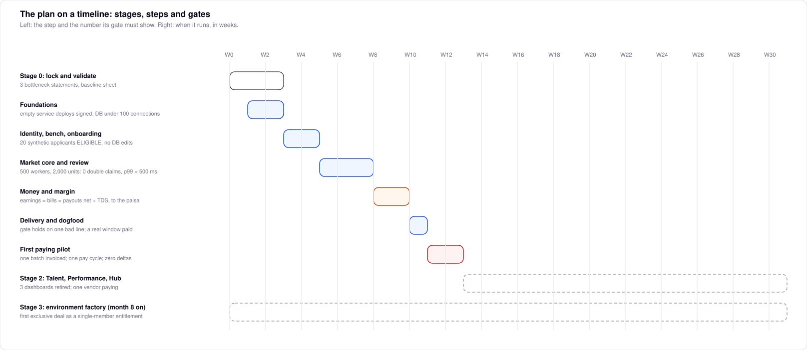

# Yantra: the unified plan

- **Status:** proposal, 2 November 2026. Audience: leadership and engineering.
- **Base:** the Yantra repository (`README.md`, `ARCHITECTURE.md`, `ROADMAP.md`, `MODULES.md`, `DATAMODEL.md`, `INFRASTRUCTURE.md`) is the point of truth. This is an execution plan on that base. Section 2.5 lists the places where it proposes a change; each stays a proposal until leadership accepts it.
- **Stages used throughout:** Stage 0 lock and validate · Stage 1 the working loop (weeks 1-12) · Stage 2 Talent, Performance, Hub · Stage 3 the environment factory.
- **Scope:** the business Yantra is built for, the architecture (one repository, services as separate deployables), the stages and their gates, the decisions to lock, the measures, the risks, and the alternatives considered.
- **Evidence tags:** **[D]** disclosed by the company named, **[R]** reported by press or analysts, **[E]** estimate, **[L]** read from Ethara's own repositories, **(assumption)** to confirm.
- **Companions:** [Understanding Yantra](01-understanding-yantra.md) (the plain-language guide), [System design](02-system-design.md), [User flows](03-user-flows.md), [Tech stack](04-tech-stack.md), [The screens](mockups/unified-plan.html) (one screen per journey). Every diagram can be edited in draw.io.

## Contents

1. Summary
2. The business
3. Principles
4. Architecture: one repository, a ring of services
5. Stages and gates
6. Decisions for leadership
7. Measures and kill criteria
8. Risks
9. Alternatives considered

---

## 1. Summary

Yantra sells **trusted, quality-scored human work to AI labs and environment vendors**, run on one platform, and never becomes a horizontal marketplace. The platform finds people, proves what they can do, keeps them on a bench, puts them on work, measures the work, pays on accepted units, prices every unit with a known margin, and turns accepted work into artifacts with lineage that can be delivered once or licensed many times.

The build is a closed loop first: vet, onboard, claim, review, pay, deliver, invoice, with real money moving in a twelve-week Stage 1. Three product pillars follow on demand (Talent, Performance, Hub), and an environment factory in one or two verticals becomes a business line only after two buyers confirm it. Every stage ends with measured evidence; nothing ships on intent.

The code lives in **one repository** and runs as **a ring of services**, each its own deployable with its own database, behind one gateway, around Odoo 19 Community Edition as the system of record for people and money. Keycloak is identity from day one.

---

## 2. The business

### 2.1 What is sold, to whom, in what order

| Order | Offer | Buyer | Evidence it is wanted |
|---|---|---|---|
| Now | managed per-unit delivery on a credentialed bench: tasks defined by the client, worked by verified contractors, reviewed, delivered with a manifest and invoiced per accepted unit | environment vendors, then labs | existing prime-vendor work [L]; labs pay $200-2,000 per calibrated task [E] |
| Month 7 on | an environment factory in one or two verticals (ERP replicas on Odoo, Indian finance and tax workflows, credentialed medicine or law, Indic language), shipped as signed, conformance-tested artifacts with an automated quality gate | labs and vendors buying exclusive or shared environments | replicas ~$20K, clones ~$300K, exclusivity 4-5x [E] |
| After | existing hubs (DataVendor, Prime Intellect, Hugging Face) as **channels** for non-exclusive surplus, never as the product | the long tail | hubs already exist; distribution is cheaper to rent than to build |
| Only behind a non-Indian entity | hourly engagements with a bought tracker | clients who insist | misclassification risk [R] |

### 2.2 Why India is the edge

- Cost: an expert at $15-40 per hour against $85-125 in the US [E].
- Compliance that no Western platform handles natively: TDS, GST, the Social Security Code levy, DPDP consent.
- Domestic rails: Razorpay, no foreign exchange, payout setup inside the app. A comparable platform lost 60% of applicants at payout setup before fixing the flow [D].

### 2.3 What is not built

- A horizontal marketplace. The repository's envelope of 20K onsite and 200K online workers stays the design ceiling; year one is sized at 3,000 registered and 500 concurrent and measured before any extraction.
- Recruiting ahead of signed demand. Verified people with no work churn and complain publicly.
- Appraisals for non-tasking staff; that is the ERP track on the existing addons.
- Hourly pay by default. Trackers are the evidence misclassification suits use [R].

### 2.4 Year-one scale (inside the repository's envelope)

| Quantity | Assumption | Design response |
|---|---|---|
| Registered workers | 1,000-3,000 | one `market` database; worker rows off the hot path |
| Concurrent active workers | 300-500 | claim = one short transaction with `SKIP LOCKED` |
| Peak claims per second | 5-20 | indexed available set; p99 under 500 ms |
| Units per batch | 1,000-20,000 | background import; paginated views; chunked export |
| Reviews per day | 5,000-20,000 | bounded JSON answers; artifacts in S3 |
| Pay window | weekly, 1,000-3,000 workers | chunked job under a lease; vendor bills in chunks of 200 |

### 2.5 Relationship to the repository documents

| Plan element | Repository source | Status |
|---|---|---|
| Hub-and-spoke shape; Odoo 19 CE as the system of record; nine services; database per service; Keycloak; NATS JetStream with CloudEvents; gateway as the only ingress | `ARCHITECTURE.md`, `INFRASTRUCTURE.md` | as specified |
| Module choices, OCA substitutions, licence obligations | `MODULES.md` | as specified |
| Work-unit, claim, verdict, earning and payout tables | `DATAMODEL.md` | as specified; this plan adds a price card, a rubric version, a reason code and cost fields per unit |
| Phases 0-6 and their verification criteria | `ROADMAP.md` | kept; this plan proposes running a thin slice of Phases 0, 4 and 5 first as a working loop with real money, while Phases 1-3 continue on the existing addons |
| The load test at 200K registered and 20K concurrent claims | `ROADMAP.md` Phase 5 | kept as the ceiling test; year one is sized at 3,000 registered and 500 concurrent, measured before extraction |
| Submodule per service | `README.md`, `CONTRIBUTING.md` | **proposal:** fold into one repository (section 4.2) |
| Stripe Connect as the primary payout rail, Razorpay for India | `ARCHITECTURE.md` | **proposal:** Razorpay first, because the paying entity is Indian; Stripe Connect when a non-Indian entity exists |
| `hub` and `runner` services; the environment factory | not in the repository | **proposal:** Stage 2 prototype, Stage 3 business line |
| `assess` runtime inside the Odoo image for Stage 1 | `ARCHITECTURE.md` lists `services/assess` as its own service | **proposal:** the Assessment v2 engine already runs there; it moves to its own deployable in Stage 2 |

---

## 3. Principles

1. The canonical accept verdict is the only money event. No accept, no pay, no invoice.
2. Every work unit stores the rubric version it was judged against, and every rejection carries a reason code. A reviewer can flag "rubric unclear".
3. Skills carry an evidence level: claimed (resume), verified (assessment), proven (performance). Never mixed in one field.
4. Every unit has a sell-side price frozen at publish and a cost (pay, review, seeds, rail fees, levy) recorded at accept. Margin per batch is visible weekly, and a batch below its floor cannot go live without a recorded approval.
5. Workers are bench members, not project hires. Projects end, people return to the bench at zero cost. Keep about 3 verified people per committed seat. Never recruit without signed demand.
6. One repository, many deployables. Each service owns its data, publishes its contract, and ships on its own pipeline. Nothing calls another service's database.
7. Reuse first: Assessment v2 is `assess`, the Strix claim pattern is `market`, Odoo accounting is the ledger, the Flutter client is the app, Razorpay is the rail, Keycloak is identity.
8. Identity is bound to the payout account. One bank account per worker. Changing it needs step-up authentication and a 72-hour hold after any account recovery.
9. No profit lever lowers contributor pay. Rates are shown before work is accepted. Pay reliability is published.
10. Evidence at every gate. Nothing ships on intent.

---

## 4. Architecture: one repository, a ring of services

The shape, the service names and the integration rules below are the repository's (`ARCHITECTURE.md`, `INFRASTRUCTURE.md`). Two things are proposals: folding the submodules into one repository (4.2) and two additional services, `hub` and `runner` (4.3).

### 4.1 Shape

Odoo 19 CE is the hub: the system of record for people, skills, contracts, accounting (GST, TDS), projects and client billing. A ring of services owns the high-volume and specialised paths. The Flutter app is the single face for workers, reviewers and mobile staff, and reaches the ring only through the gateway. State flows into Odoo asynchronously through outboxes and the bus.



### 4.2 The repository

The hub repository `yantra` stays the base. The proposal is to fold the eleven submodules (the app, nine services, deployment) into it as directories, trunk-based, with every deployable and its chart beside the code that produces it. The service names, the database-per-service rule and the charts are unchanged.

```
yantra/
  app/                    Flutter: worker, reviewer, onboarding, earnings, ops-on-mobile journeys
  services/
    gateway/              JWT validation, rate limits, idempotency, retry absorption, public OpenAPI
    assess/               Assessment v2 contract: papers, certification events, skills write-back
    market/               projects, batches, units, claims, price cards, assigned mode, delivery gate
    quality/              review claims, verdicts, audit sample, reason codes, calibration, trust
    payout/               earnings, pay windows, holds, cost ledger per unit, rail adapters
    notify/               the only holder of messaging credentials: email, FCM, WhatsApp
    odoo/                 Odoo 19 CE image, OCA modules, ethara_* addons (workforce, api, accounting glue)
    hub/                  Stage 2: registry of datasets, environments, models; lineage; rights; entitlements
    runner/               Stage 2 prototype, Stage 3 production: determinism, pass-rate band, reward-hack audit
    tracker/              scaffold only, until a client insists on hourly pay
    analytics/            scaffold only, until CDC read models are needed
  packages/
    contracts/            OpenAPI per service, CloudEvents schemas, generated Dart and Python clients
    py-common/            auth, tracing, outbox publisher, idempotency, config, test fixtures
  deployment/
    charts/<service>/     one Helm chart per deployable
    argocd/               app-of-apps per environment
    policies/             Kyverno, network policies, egress allow-list
    terraform/            Postgres, Redis, S3, Keycloak, NATS
  tools/                  claim-storm harness, fixtures, data generators, migration helpers
  docs/                   this plan, ADRs, runbooks per job and adapter
```

Rules that keep one repository from becoming one application:

| Rule | Meaning |
|---|---|
| A service imports only `packages/*` | never another service's code; cross-references are ids, not foreign keys across databases |
| Database per service | each service owns its schema and migrations; no cross-database joins; read models are built from events |
| Synchronous calls go through the gateway contract, asynchronous through the bus | a service never calls another service's database or internal URL |
| Transactional outbox everywhere | every state change that others care about is written to the service's outbox in the same transaction and published to NATS by a relay |
| A contract change and all its consumers land in one pull request | the generated clients in `packages/contracts` are rebuilt in CI; a stale consumer fails the build |
| Affected-only CI, one release train | path filters run the tests, contract tests and image build of what changed; every image is signed, carries an SBOM and is tagged per service |
| Every service ships four things | a Dockerfile, a Helm chart, migrations, and a runbook; a service without a runbook does not deploy to production |
| Decisions are written down | an ADR in `docs/adr` for every choice that constrains more than one service |

### 4.3 Services: what each owns, in which stage

| Service | Owns | Stage 1 | Later |
|---|---|---|---|
| `gateway` | the only ingress for the app: Keycloak JWT validation, per-worker rate limits with 429 and Retry-After, idempotency keys for every mutation, retry absorption, the public OpenAPI contract | built in full; routes for assess, market, quality, payout, notify, odoo | buyer Organizations and step-up for the client console |
| `assess` | papers generated from the project SOP, proctored sittings, certification tag, retake policy, outcome events, skills write-back with evidence level | the Assessment v2 engine behind its own contract and route; its runtime stays in the `odoo` image for Stage 1 (the one exception to a service per deployable) | extraction into its own deployable in Stage 2; credential checks against issuers; AI interviews in Stage 3 |
| `market` | client projects, batches, work units, claims with `SKIP LOCKED` and TTL, import with dry run, price card with `unit_price` frozen at publish, assigned mode, rubric version on every unit, delivery gate and manifest | built in full | quote engine with tiers; agentic unit types (trajectory, rubric, pairwise, grader check) in Stage 2; authoring tasks in Stage 3 |
| `quality` | review claims (never own work), single review plus a 10% audit sample, the canonical verdict, reason codes, the "rubric unclear" flag, client-caused rework marked billable, review earnings | built in full | calibration, seeded gold, advisory LLM pre-review, disputes, trust score per domain in Stage 2; the runner verdict as a review stage in Stage 3 |
| `payout` | earnings on the accept event, weekly pay window (Saturday to Friday IST), holds, cost ledger per unit (pay, review, audit, rail fee, levy), statements; rail adapters (RazorpayX, bank file) | built in full; vendor bills with TDS and two-person approval raised in Odoo through the bus; reconciliation to the paisa | a second rail or country |
| `notify` | the only holder of messaging credentials; templates; delivery log | email | FCM and WhatsApp with the mobile build |
| `odoo` | the system of record: worker record, agreements, DPDP consent, documents, the **bench** (skills with evidence level, availability stale after 14 days, past quality), accounting, self-billed vendor bills with TDS, client invoices, margin report | the `ethara_workforce`, `ethara_api` and accounting glue addons on a separate `yantra` deployment of the existing image | OCA `queue_job`, `sign_oca`, `fs_attachment` after the licence audit |
| `hub` | datasets, environments and models as versioned entries with cards, lineage to units and people, a rights field enforced in queries, delivery mappings; entitlements with an exclusivity class; signed OCI delivery through Harbor; OpenEnv conformance | not built | internal catalogue in Stage 2; storefront and entitlements in Stage 3 |
| `runner` | the environment quality gate: determinism replay, pass-rate band against a reference panel, reward-hackability audit; sandboxed execution | not built | standalone prototype in Stage 2 against free public environments; production in Stage 3 |
| `tracker` | activity ingestion, screenshots to S3, caps, anomaly flags | scaffold: chart and health endpoint only | built only if a client insists on hourly pay |
| `analytics` | CDC read models, BI | scaffold | Stage 3, when data exceeds what Odoo reports and the Performance views can serve |
| `app` | one Flutter codebase: apply, onboarding checklist, task list, runner, review console, earnings, ops on mobile | web first | mobile store release with FCM in Stage 2 |

### 4.4 Stack

| Layer | Choice | Why |
|---|---|---|
| Service runtime | Python 3.12, FastAPI, SQLAlchemy, Alembic; one `uv` workspace for the whole repository | one language across Odoo and the ring; the team's skill; generated clients from one OpenAPI per service |
| System of record | Odoo 19 CE, OCA modules only, `ethara_*` addons | ledger, HR, skills, access rules and India localisation come free; no Enterprise code |
| Client | Flutter, single codebase, gateway-only networking | the design system, API client and proctoring exist; mobile for Indian gig workers from the same code |
| Identity | Keycloak: OIDC for staff into Odoo, JWT for workers and service-to-service | built; one realm in Stage 1; buyer Organizations later |
| Events | NATS JetStream with CloudEvents envelopes; transactional outbox in every service; no broker client inside Odoo (an outbox bridge instead) | at-least-once delivery with idempotent consumers; replay for new read models |
| Database | PostgreSQL, one database per service on a dedicated server, PgBouncer in transaction mode, PITR; Crunchy or Percona operator in Stage 3 | the shared primary is the proven bottleneck [L]; an operator needs a platform owner |
| Locks and jobs | lease rows for every scheduled job; `queue_job` in Odoo after the licence audit | session advisory locks leaked under pooling [L] |
| Cache and idempotency | Redis | idempotency dedup with a unique-constraint fallback in Postgres |
| Files | S3 with per-project prefixes, IAM roles, SSE-KMS, presigned URLs of five minutes | bytes never cross Odoo or the gateway |
| Payments | Razorpay (RazorpayX payouts) primary; bank file fallback | Ethara's existing Indian provider; a global rail needs a non-Indian entity |
| AI | Vertex Gemini through one client with a cost ledger and quota guards; no third-party proxy | the proxy is the breach vector [R] |
| Ingress and delivery | Istio as deployed; Argo CD app-of-apps; Helm chart per service; Harbor, cosign, SBOM, Kyverno | supply chain is the lesson from the incumbents' incidents [R] |
| Observability | Prometheus, Grafana, Loki, OpenTelemetry traces across gateway and ring, Sentry | a request is traceable from the app to the ledger |
| CI | GitHub Actions with path filters; contract tests; fresh-database tests per service; the claim-storm harness as a gate | affected-only builds keep one repository fast |

### 4.5 Integration rules

| Pattern | Rule |
|---|---|
| Worker mutation | app → gateway (idempotency key) → service database → outbox → bus → Odoo ledger. Never a synchronous write path from the app into Odoo tables |
| Events out of Odoo | `ethara.outbox` rows written by `ethara_*` models, drained by a lease-locked cron into NATS; no broker client in the Odoo process |
| Calls into Odoo | native `@http.route` controllers in `ethara_api` secured by Keycloak JWT; no in-Odoo REST framework; XML-RPC forbidden for new work |
| Hot paths | the claim path writes only unit and claim rows; no counters on worker or batch rows; no chatter per claim; task lists show no counts |
| Contention | retries with backoff on Odoo lock errors; hot rows live in service databases |
| Money | the accept event from `quality` is the only trigger for an earning in `payout` and a bill in `odoo`; nightly reconciliation alerts and never auto-adjusts |

---

## 5. Stages and gates



### Stage 0: lock and validate (weeks 0-2, parallel with the foundations step)

No counterpart in `ROADMAP.md`; this is the commercial and legal work that lets Stage 1 build against a real pilot.

| Work | Owner | Evidence |
|---|---|---|
| Lock the decisions in section 6 | sponsor, product owner | signed decisions table |
| Record baselines on 2-3 live projects: time to staff, recruiter hours per hire, QC cost per unit, rework rate, idle cost | ops | a baseline sheet |
| Interview 5 environment vendors and 2 lab procurement teams: cost per calibrated task, QA pass-through, throughput they cannot hire | sales, CTO | 3 quantified bottleneck statements; 2 written requests |
| Counsel: contractor agreement, NDA, IP assignment, DPDP roles, levy scope. Chartered accountant: TDS section, LUT | finance | opinions on file |
| Open the SOC 2 Type 2 window | CTO | engagement letter |
| Run the bench flow on a spreadsheet with a small group | ops | the flow understood before it is coded |

### Stage 1: the working loop on a bench (weeks 1-12)

Maps to `ROADMAP.md` as a thin slice of Phase 0 (foundation), the contractor part of Phase 4 (online workforce foundation) and the core of Phase 5 (task marketplace and payments). Phases 1-3 (HRMS, Finance, ITMS) continue in parallel on the existing addons.

| Step | Weeks | Delivers | Gate |
|---|---|---|---|
| Foundations | 1-2 | the repository laid out as in 4.2 with the former submodules folded in; CI with path filters, signed images, SBOM; a Helm chart and Argo CD application per service; NATS JetStream; Keycloak realm wired to the gateway; a dedicated Postgres server with one database per service, PgBouncer, PITR; Redis; S3 prefixes and IAM; `packages/contracts` with the first OpenAPI and event schemas; the claim-storm harness; alerts and the egress allow-list | an empty `market` service deploys to staging through the pipeline with a signed image, health checks and a trace; the harness runs at 1.5x the largest cohort with zero errors; the production database stays under 100 connections at rest |
| Identity, bench, onboarding | 3-4 | gateway in full; worker record, click-wrap agreements, DPDP consent, documents and the bench record (skills with evidence level, availability) in `odoo`; `worker.eligible` on the bus and a worker read model in `market`; Assessment v2 outcome events, certification tag and retake policy behind the `assess` contract; identity bound to the payout account; the hard-question apply form; payout setup inside the app | 20 synthetic applicants reach ELIGIBLE with no database edits; zero cross-worker reads; worker tokens expire within 24 hours |
| Market core and review | 5-7 | `market`: projects, batches, units, import with dry run, publish (freezes `unit_pay` and `unit_price`), claim with `SKIP LOCKED`, submit, skip, TTL release, assigned mode, rubric version on every unit; `quality`: review claims, verdicts, audit sample, reason codes, the "rubric unclear" flag, billable client rework; Flutter task list, runner and review console; margin floor as a warning with a recorded approval | 500 simulated workers on 2,000 units through the gateway: zero double claims, p99 under 500 ms; reviewers never draw their own work; a batch below its margin floor cannot publish without approval |
| Money and margin | 8-9 | `payout`: earnings on the canonical verdict, pay window, holds, cost fields per unit, statements; `odoo`: self-billed vendor bills with TDS, two-person approval, RazorpayX sandbox, bank-file fallback, reconciliation; margin report per batch and project | 50 workers and 1,000 units: earnings equal bills equal payouts net plus TDS to the paisa; the margin report equals the invoice minus every cost line |
| Delivery and dogfood | 10 | delivery gate and manifest in `market`, client invoice in `odoo`, retention purge; an internal batch of 300-500 units worked by existing taskers; the four numbers on the ops dashboard; runbooks per service | the gate holds a batch on one bad line; a real pay window paid; the invoice equals accepted units times rate |
| First paying pilot and go/no-go | 11-12 | the first paying client project on the platform; people return to the bench when the batch ends; the next batch staffed from the bench; on-call rota and alerts live | one real batch delivered and invoiced; one real pay cycle; zero double claims and zero reconciliation deltas; days to staff the second batch under the baseline |

### Stage 2: Talent, Performance, Hub (weeks 13-30, on demand and in parallel squads)

Maps to the rest of Phases 4 and 5 and the first part of Phase 6 (AI layer and intelligence) in `ROADMAP.md`, plus the internal Hub.

| Pillar | Delivers | Gate |
|---|---|---|
| Economics | quote engine: price = expected cost / (1 − target margin) from observed cost per client and task type; tiers by quality (standard, premium, gold) and turnaround (standard, rush); margin drift alerts on live batches; a unit-economics fact table | quotes within 10% of actual cost on 3 batches |
| Platform | `assess` extracted into its own deployable; Flutter mobile with FCM; WhatsApp; a KYC provider; credential verification against issuers; LLM-use review flags; Keycloak buyer Organizations; OCA modules after the licence audit | the mobile build in a store; a credential verified end to end |
| Quality | calibration exams, seeded gold, advisory LLM pre-review, a dispute workflow, trust score per domain, reviewer ranks | dispute uphold rate tracked; seeds catch a planted bad worker in a test batch |
| Talent | resume parse, explainable match to the project SOP profile, auto-assigned paper, human sign-off on rejections, pool re-match; recruiting channels measured per channel; a fellowship with 2 institution partnerships | one real hiring drive end to end; time to staff under the baseline; cost per verified professional per channel |
| Performance | standard signals from events; Me, Pod Lead and TPM views; gating and rate tiers from scores | 3 CSV-fed dashboards retired; numbers reconcile with the old ones on the same weeks |
| Hub, internal | registry of datasets and environments with versions, cards, lineage, rights field, delivery mappings; environment validation (an oracle passes, an empty environment fails) | deliveries from 3 projects catalogued; one client delivery shipped through the Hub |
| Runner prototype | the quality gate (determinism, pass-rate band, reward-hack audit) as a standalone tool run against 20 free public environments; findings published | the gate rejects at least one hackable environment; the write-up earns a vendor conversation |
| Client console | intake, SLA and throughput, acceptance rate, quality report, deliveries, feedback that flows back as review events | one environment vendor as a paying customer |

### Stage 3: the environment factory (months 8-12 and on)

Beyond the current `ROADMAP.md`; a proposed business line, conditional on the Stage 0 buyer conversations.

| Work | Delivers | Gate |
|---|---|---|
| One vertical | pick from: Odoo-based ERP replicas (LGPL, Ethara operates it), Indian finance and tax workflows (GSTN, TDS, UPI), credentialed medicine or law, Indic language | two buyer conversations confirm demand before the build |
| Factory pipeline | authoring tasks in `market` (agentic unit types), the runner gate as a stage in `quality`, human QA, cosign and SBOM on accept, provenance (contributor ids, IP assignment, OSS manifest) | the first environment passes the gate and a lab or vendor quality bar |
| Hub, external | entitlements with an exclusivity class (a sole licence withdraws other listings), scoped pull tokens, OpenEnv conformance, canary seeds, a thin storefront for the non-exclusive tier, hubs as channels | the first exclusive deal recorded as a single-member entitlement; the first non-exclusive listing on a hub |
| Scale and AI | CDC into `analytics`, a Postgres operator if HA demands it, AI interviews, semantic search, auto-match | triggers: more than about 3,000 concurrently active workers, p99 claim over 1 s at the load target, review contention with claims, a second payout rail or country |
| Hourly engagements | only behind a non-Indian paying entity, with a bought tracker, screenshots off | leadership decision |

### Team

Stage 1 is a squad of five to seven: a tech lead (architecture, contracts, the gateway, CI and the deploy gate, load tests, security review), three backend engineers (one on `market` and `quality`, one on `payout` and the Odoo accounting glue, one on `assess`, `notify` and the workforce addon), one Flutter engineer (worker, reviewer, onboarding and earnings journeys), a named DevOps owner at two days a week (charts, Argo CD, NATS, Postgres, Redis, alerts), optional QA (the claim-storm harness, end-to-end scripts, fresh-database CI), and a finance lead (pay-window approvals, TDS rules, the RazorpayX account, bank files). Stage 2 adds a Talent pair and a Performance pair; the runner prototype and Stage 3 need two to three engineers with RL or verifier experience.

Ways of working: a weekly demo against the gate, not against intent; every step ends with measured evidence; nothing from Stage 2 starts before the lock; an incident produces a configuration or a test, never a workaround; every service has an owner by role and a runbook before it reaches production.

---

## 6. Decisions for leadership

Every decision has a default, so the build can start before the meeting. Rows marked **open** need a choice in the lock meeting or at the first paying pilot.

| Decision | Default |
|---|---|
| Model order | managed per-unit delivery on a credentialed bench now; environment factory in one or two verticals from month 8; hubs as channels; hourly only behind a non-Indian entity |
| Topology | one repository; a service per deployable with its own database from day one; Odoo as the system of record on a separate `yantra` deployment of the existing image |
| Pay basis | per accepted task; hourly only with a tracker, which is off by default |
| Worker legal model | independent contractor: self-billed vendor bill plus TDS |
| Rails, countries, cadence | India only via Razorpay (RazorpayX payouts, bank file as fallback); weekly Saturday-Friday IST window; 7-day first hold; foreign workers need a non-Indian entity |
| Client pricing | fixed unit rate per project with a stated target margin in Stage 1 |
| Pricing method (**open**, decide at the first paying pilot) | from Stage 2: quote = expected cost / (1 − target margin), by tier and turnaround; margin floor per batch as a warning with a recorded override |
| Data ownership and resale | client-owned by default; Ethara-funded runs flagged for reuse or licensing; retention 180 days |
| First clients | an internal dogfood batch, then one existing prime-vendor project, then one small environment vendor, then a lab |
| Public positioning | the platform brand for managed delivery and the credentialed network; no 200K-worker marketplace claim |
| Delivery and billing format | JSONL plus manifest; per-unit invoice; e-invoicing only for Indian clients |
| Task source | client-defined, imported with a dry run; authoring in Stage 3 |
| Quality model | single review plus a 10% audit sample; double-blind available per batch; the accept verdict is the only money event |
| Gating | certification exam plus optional seeded gold |
| KYC depth | PAN plus penny drop; a KYC provider in Stage 2 |
| AI use on tasks | per-batch flag; paste off by default |
| Domain | a Yantra subdomain of ethara.ai |
| Identity | Keycloak, one realm, from Stage 1: OIDC for staff, JWT for workers and services; buyer Organizations and step-up only when a buyer demands SSO or money moves outside two-person approval |
| Bench policy | contractors return to the bench at project end; 3 verified people per committed seat; availability stale after 14 days |
| Recruiting rule | never without signed demand; channels measured on cost per verified professional |
| First factory vertical (**open**, decide after the Stage 0 interviews) | one of the four candidates in Stage 3 |
| Levy | priced into every rate card as a line item from day one, before the Social Security Code rate is notified |
| Rubric and reason codes | rubric version on every unit; reason code mandatory on every rejection; "rubric unclear" routes to the TPM within 2 days |
| Quality gate for environments | determinism replay, pass-rate band, reward-hack audit; a finding is a hard fail |
| Artifact contract | OpenEnv, pinned per version; Harbor-signed OCI images; Hugging Face Hub for the free tier only |
| Trust score scope (**open**) | per domain, not global |
| Data products | only artifacts Ethara funded and owns; rights field enforced in queries; legal review of each licence template |

---

## 7. Measures and kill criteria

### The four numbers (reported from the delivery step onward)

1. Days to staff a project: baseline vs bench.
2. Idle cost: baseline vs bench.
3. First-pass acceptance: bench vs normal hires.
4. Cost per accepted unit delivered.

### Platform measures

| Area | Measure |
|---|---|
| Overhaul | time to stand up a new project type under one week (schema, instructions, quality policy, rate card) |
| Economics | contribution margin per client and task type; quote accuracy; review cost over contributor pay; cash gap in days; **north star: gross margin per accepted unit** |
| Quality | first-pass acceptance per batch; rework depth; dispute uphold rate; assessment-score vs 30-day QC-score correlation |
| Supply | cost per verified contributor per channel; verified-to-first-accepted ratio; active over registered; credentialed pool per category; 90-day retention |
| Trust | fraud per 1,000 accounts; on-time payout %; 100% of payouts reconciled before statements; security incidents (zero); zero double claims; zero reconciliation deltas |
| Platform | p99 claim under 500 ms at 500 concurrent workers; zero client-visible incidents during a batch deadline or an exam sitting; every service deployable independently within 30 minutes of a merge |
| Hub | share of deliveries through the Hub; reuse rate; environment gate pass rate; days from project close to listing |
| Customers | number of vendor and lab customers; share of revenue from the largest; net revenue retention |

### Kill and change-course tests

- Fewer than 3 signed vendor customers in two quarters: the neutral-supply thesis has not held; sell direct or stop.
- Task prices or volumes fall two quarters in a row, or two labs complete insourcing: shrink the factory ambition.
- Exclusivity premium quoted below 2x: list more aggressively on hubs.
- Verified-account fraud rate stays high after two quarters: change geography or price point.
- The bench is not faster and cheaper on the four numbers after the pilot: stop the bench, keep the contractor structure.
- A failed Stage 1 gate, or a lock outcome that picks hourly pay or an employee model: replan before building further.

---

## 8. Risks

| Risk | Safeguard |
|---|---|
| Database connection exhaustion recurs | a dedicated server with one database per service; a connection budget per chart; PgBouncer; an alert at 85% |
| Locks leak under transaction pooling | lease-row locks for every scheduled job; claims in one transaction; a dedicated cron pod in Odoo |
| Double claim or double pay | unique indexes; the quality verdict as the only trigger; idempotent consumers; nightly reconciliation that alerts and never auto-adjusts |
| A distributed system before the team has run one | the transactional outbox and idempotency in `packages/py-common`, not re-written per service; a trace from app to ledger on every request; runbooks before production; a named DevOps owner |
| Contract drift between services and the app | generated clients from one OpenAPI per service; a contract change and its consumers in one pull request; contract tests in CI |
| Supply-chain compromise | slim hash-pinned signed images; SBOM and scans; no third-party LLM proxy; egress allow-list; secrets outside the database |
| Client data confidentiality | per-project storage prefixes; five-minute presigned URLs; blind rules; audit trail; retention purge |
| Payment fraud | PAN and penny-drop checks; one bank account per worker; reviewer never author; holds and caps; two-person approval; webhook signatures |
| Business-model churn after build | the thin loop; pay basis, quality policy and settlement as configuration; events as the seams |
| Deploy errors | one-shot migration job per service; a deploy gate on contract versions; fresh-database CI |
| Bus factor | ownership by role; a named DevOps owner; runbooks per job and adapter |
| Worker trust | notice before repricing or offboarding; published pay windows; disputes answered within the next window |
| Margin engine read as pay cuts | principle 9; rates visible before claim; pay reliability published; no lever touches contributor pay |
| Performance tracking felt as surveillance | self-view first with the same data the lead sees; tracking only where a contract requires it |
| Misclassification (India Code on Social Security; US suits cite trackers) | output-based contracts; tracker off; levy priced in; counsel review per country before any foreign supply |
| Reselling data Ethara does not own | rights field on every artifact, enforced in queries; legal review per licence template |
| A shipped hackable environment | the runner gate is a hard fail; an escape is a severity-one defect |
| Offshore supply fails a lab's quality bar | calibration gating and seeded gold before capacity is promised; measured in the Stage 2 vendor pilot before the factory |
| Social-media recruiting looks like a scam | own domain only, named team, no direct messages, post the work not the job; associations and WhatsApp for senior professionals |
| Recruiting ahead of demand | the recruiting rule; verified people with no work churn and complain publicly |
| OpenEnv churn | pin the OpenEnv version per artifact; conformance as a build target |

---

## 9. Alternatives considered

| Question | Options considered | Choice | Why |
|---|---|---|---|
| Topology | (a) Odoo addons with service boundaries, extracted on measured triggers; (b) a service per deployable from day one; (c) nine full services plus registry, runner and a storefront from day one | **(b)**, with `tracker` and `analytics` as scaffolds and `hub` and `runner` from Stage 2 | hot paths are isolated from Odoo from the first batch; teams ship independently; the cost is about three weeks and a named platform owner, paid once |
| Repository layout | one repository; one repository per service as submodules | **one repository** | a contract change lands with its consumers in one pull request; one CI; one place to read |
| Identity | Odoo users now, Keycloak later; Keycloak from day one | **Keycloak from day one** | it is built; service-to-service JWTs are needed from the first deployable |
| Events | an outbox table drained in-process; NATS from day one | **NATS from day one**, with a transactional outbox in every service | the first consumer outside the Odoo process exists in Stage 1 |
| First customer | an internal project; existing prime-vendor work plus a direct lab pilot; a small environment vendor first | **dogfood, then prime vendor, then a small vendor, then a lab** | each step is cheaper to win than the next and produces the evidence the next one asks for; a lab needs SOC 2 and gate evidence |
| Scale target | 200K registered; tens of thousands; 3,000 registered and 500 concurrent in year one | **3,000 / 500**, 200K as the ceiling | a comparable platform runs about 30K weekly active [E]; measure before extracting |
| Business-model order | several labellings of the same sequence | managed per-unit on a bench, then the factory, then hubs as channels; data products are what the factory produces, not a separate line | one sequence, one vocabulary |
| Pricing in Stage 1 | a quote engine with quality and turnaround tiers now; one fixed rate per project with a price card and actual margin | **fixed rate now, tiers in Stage 2** | tiers need observed cost per unit, which does not exist before the money step has run |
| Margin floor | a hard block on publish; a warning with a recorded approval | **warning plus approval** in Stage 1 | a hard block with no cost history would block the dogfood batch before any cost history exists |
| Talent pillar | resume parsing and matching in Stage 1; a hard-question apply form plus Assessment v2 now and matching in Stage 2 | **form now, matching in Stage 2, AI interviews in Stage 3** | matching needs a pool to match across |
| Dashboards | standard signals from events for everyone now; a margin report and the four numbers now, Performance views later | **margin report and the four numbers in Stage 1; Performance in Stage 2** | the event stream from Stage 1 is what Performance reads |
| Recruiting | recruit 200 credentialed contributors in two domains before the pilot; recruit only against signed demand | **only against the pilot project**, unless a vendor signs in Stage 0 | verified people with no work churn and complain publicly |
| Spreadsheet first | run the whole loop on a sheet; run only the bench flow on a sheet | **bench flow only** | claim, review and pay are already proven in code; the sheet is for the one flow that is new |
| Client login in Stage 1 | a client console now; a manifest, an invoice and a weekly report now | **no client login in Stage 1** | the console earns its keep when the first vendor pays, in Stage 2 |
| Mobile | no mobile until later; mobile in Stage 2 | **Stage 2** | Indian gig workers are on phones, and the Flutter codebase makes mobile nearly free once the web journeys exist |
| Environment factory | a capped side channel; a business line from day one; a conditional Stage 3 line | **conditional Stage 3 line** | three independent research threads put the premium in exclusive environments (4-5x [E]); the risk is handled by the gate, not by capping the line |
| Factory services | registry, runner and a storefront as full services before a buyer exists; the quality gate alone as a Stage 2 prototype | **gate first** | the gate is the only piece with evidence value before a buyer exists |
| Keycloak depth | two realms and three authentication levels now; one realm now, Organizations and step-up on demand | **one realm now** | no second identity source exists yet; step-up lands with the first money movement outside two-person approval |
| ML hires | hire 2-3 ML engineers for verifier tooling now; only when Stage 3 is approved | **only when Stage 3 is approved** | the Stage 2 prototype runs against free environments with the tech lead plus one engineer |
| SOC 2 | later; open the Type 2 window now | **now, in Stage 0** | cheap to start and the longest pole in any lab conversation |
| Hub as revenue | a licensing line from Stage 2; Ethara-funded artifacts only, from Stage 3 | **Stage 3, Ethara-funded only** | work produced under a client contract belongs to the client |
| Appraisals for non-tasking staff | inside Performance; the ERP track | **ERP track** | no event data exists for it; it moves no gate |
| Tracker | on by default for evidence; off by default | **off by default** | trackers are the evidence misclassification suits use [R] |
