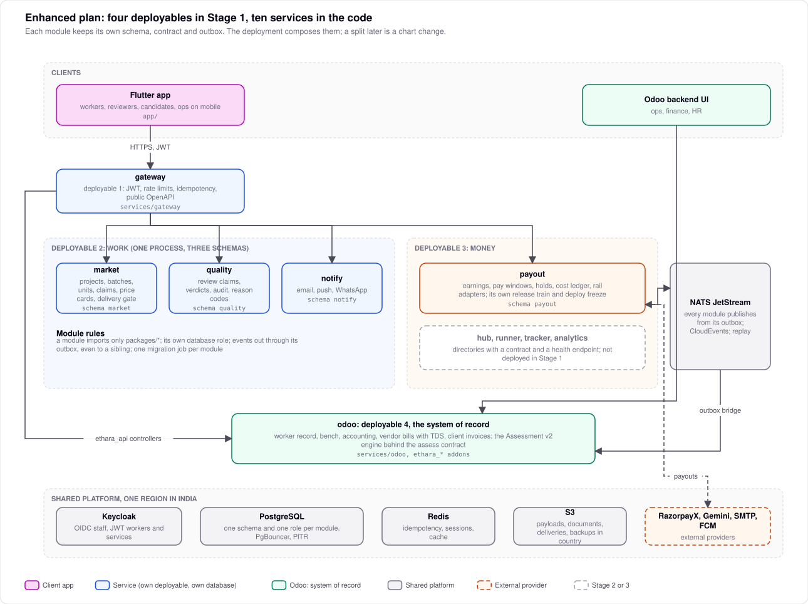
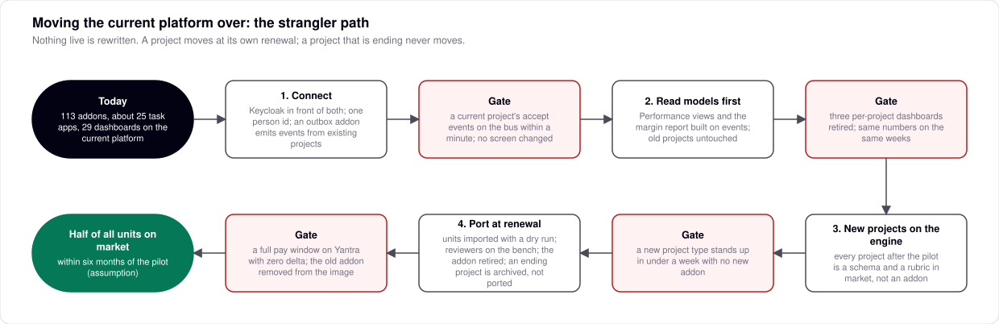
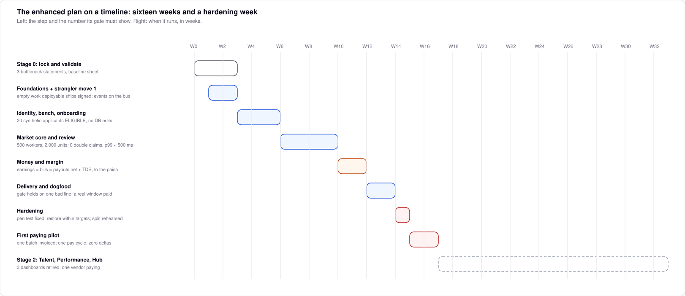

# The enhanced plan

- **Status:** proposal, 2 November 2026. A second option next to the unified plan, for leadership to compare.
- **What it is:** the unified plan with its known gaps filled. Same business, same stages, same gates, same service contracts, same repository rules. What changes: how many things run in year one, how long Stage 1 takes, how the current platform moves over, and what was missing (cost, recovery targets, testing, versioning, service levels, a security calendar, data residency).
- **Base:** the Yantra repository documents stay the point of truth, as in the unified plan. Every change in this page is marked as a proposal.
- **Evidence tags:** **[D]** disclosed by the company named, **[R]** reported, **[E]** estimate, **[L]** read from Ethara's own repositories, **(assumption)** to confirm.

## Contents

1. What this version changes, in one table
2. Architecture: four deployables in Stage 1, ten services in the code
3. Moving the current platform over: the strangler path
4. Stage 1 in sixteen weeks
5. What it costs to run
6. Recovery and availability targets
7. Testing strategy
8. API and event versioning
9. Service levels and error budgets
10. Security and compliance calendar
11. Data residency
12. Decisions this version adds
13. Side by side: the unified plan and the enhanced plan
14. What did not change

---

## 1. What this version changes, in one table

| Gap in the unified plan | What the enhanced plan does | Why it is better |
|---|---|---|
| Ten services running from day one for five to seven engineers and 500 concurrent workers | four deployables in Stage 1 (gateway, work, money, odoo); the ten services stay as separate code modules with their own schemas, contracts and outboxes | half the operational surface, the same boundaries; a split later is a chart change, not a rewrite |
| Twelve weeks for the whole loop | sixteen weeks, with a hardening week (penetration test, recovery drill, load test) before the paying pilot | the twelve-week version had no slack and no security test before real money |
| No path from the current platform (113 addons, about 25 task apps, 29 dashboards) to Yantra | a strangler path in four moves with a gate each: connect, read models, new projects on the engine, port at renewal | nothing live is rewritten; the old and new run side by side until a project renews |
| No running-cost estimate | a monthly cloud estimate per line, an AI budget per unit with a quota guard, third-party fees | leadership can approve a number, not a direction |
| No recovery targets | recovery point 15 minutes, recovery time 4 hours in Stage 1 and 1 hour in Stage 2; a restore drill every month; a game day in the hardening week | a pay window that cannot be restored is a trust failure, not an outage |
| Testing described as a harness and gates | a test pyramid per deployable with a coverage bar, contract tests, record-rule tests, the claim-storm harness and an end-to-end script per flow | every gate is a test that runs in CI, not a demo |
| No rule for changing an API or an event | additive-only changes, a version in the path, a 90-day deprecation window, versioned event schemas with a consumer registry | the app and the services can ship on different days |
| No service levels | availability 99.5% in Stage 1 and 99.9% from Stage 2, p99 claim under 500 ms, pay window closed on time 100%, an error budget that pauses features | "it is fast enough" becomes a number that is measured |
| No security calendar | one dated list: secrets rotation, dependency scans, record-rule tests, a penetration test before the pilot and every quarter, the SOC 2 window | security stops being a workstream and becomes a calendar |
| Region and data residency unstated | one region in India, worker and client data never leave it, backups copied inside the country | the data protection law and client contracts both ask for this |

---

## 2. Architecture: four deployables in Stage 1, ten services in the code

### 2.1 The idea

The unified plan's service boundaries are right. Its deployable count is a cost paid before it earns anything. Year one runs at about 500 concurrent workers; the repository's own capacity model says the marketplace hot path at that size is one short transaction per claim. Nothing at that size needs ten processes to scale independently.

So the code keeps ten services as separate directories, each with its own schema, migrations, OpenAPI contract, outbox and tests, exactly as the unified plan lays them out. The deployment composes them into four running things:

| Deployable | Contains | Why it is its own process |
|---|---|---|
| `gateway` | the gateway service | the edge: rate limits, JWT validation, idempotency; scales on request count, never on database load |
| `work` | the `market`, `quality` and `notify` modules, each on its own schema, in one FastAPI process | the claim, review and notification paths share one request budget; splitting them buys nothing at 500 workers |
| `money` | the `payout` module | money code ships on its own release train and has its own approvals, caps and audit; the one module that must never be redeployed by accident |
| `odoo` | Odoo 19 CE, the `ethara_*` addons, and the Assessment v2 engine behind the `assess` contract | the system of record, as in the repository |

`hub`, `runner`, `tracker` and `analytics` are directories with a contract and a health endpoint, as before. NATS, Keycloak, PostgreSQL, Redis and S3 are unchanged.

### 2.2 The rules that keep the modules separate inside one process

| Rule | How it is enforced |
|---|---|
| A module imports only `packages/*` and its own code, never another module | an import-linter contract in CI; the build fails on a cross-module import |
| A module owns its schema; no cross-schema query | a separate database role per module with grants on its own schema only; the test suite runs each module against a database where the other schemas do not exist |
| Modules talk through events and contracts, never function calls | the outbox relay publishes to NATS even when the consumer runs in the same process; a consumer that calls a sibling's function fails the import-linter |
| Each module has its own migrations, run by its own one-shot job | one Alembic environment per module; the `work` chart runs three migration jobs in order |
| Splitting is a chart change | a second Helm values file runs `quality` alone; the split is rehearsed in staging in the hardening week so that it is known to work before it is needed |

### 2.3 When a module leaves the process

The unified plan's triggers stay: more than about 3,000 concurrently active workers, p99 claim over 1 second at the load target, review contention with claims, a second rail or country. One trigger is added: a module that needs a different release cadence from its neighbours (the reason `payout` is separate from day one).

### 2.4 What this costs

Three things, each small: the import-linter and the per-module database roles (two days), the rehearsed split in staging (one day in the hardening week), and the discipline not to take the shortcut of a function call across modules (a review rule). Against that, the Stage 1 team runs four charts, four on-call surfaces and four dashboards instead of ten.

### 2.5 Events: NATS stays

An alternative was weighed: a Postgres outbox with polling consumers and no broker in year one. It was rejected. The Odoo consumer runs in a different process from day one, read models need replay, and the repository ratified NATS JetStream for good reasons. A three-pod NATS cluster is a modest surface; the relay and the idempotent consumer live once in `packages/py-common`.

---

## 3. Moving the current platform over: the strangler path

The current platform runs on Odoo 19 with 113 addons, about 25 per-project task or pipeline applications and 29 per-project dashboards [L]. The unified plan reuses pieces of it (Assessment v2, the claim pattern, the Flutter client, Razorpay) but never says how a live project moves. This section does, in four moves. Nothing live is rewritten; a project that is ending is never ported.

| Move | What happens | Touches live projects? | Gate |
|---|---|---|---|
| 1. Connect | Keycloak in front of the current platform and Yantra; one person id across both; the existing addons start writing to an outbox table, drained to NATS by the same relay Yantra uses | no code change inside the task apps; one addon adds the outbox | a current project's accept events appear on the bus within a minute, with no change to that project's screens |
| 2. Read models first | the Performance views and the margin report are built on those events; they work for old projects without touching their code; the four numbers are reported for old and new projects alike | no | three per-project dashboards retired because the read model shows the same numbers on the same weeks |
| 3. New projects on the engine | every project that starts after the Stage 1 pilot uses `market` and `quality`; its task app is a schema and a rubric, not an addon | no | the first new project type stands up in under a week with no new addon |
| 4. Port at renewal | when an old project renews, its units are imported into `market` with a dry run, its reviewers are on the bench, and its addon is retired; a project that ends is archived, not ported | yes, one project at a time, at its own renewal date | the renewed project runs a full pay window on Yantra with zero reconciliation delta; the old addon is removed from the image |

The ERP track (attendance, payroll, HR on the existing addons) does not move; it is already on the same system of record.

Timing: move 1 lands in the Stage 1 foundations step, move 2 in Stage 2 Performance, move 3 from the first paying pilot onward, move 4 as renewals fall due. The measure is the share of accepted units flowing through `market`, reported monthly; the target is half of all units within six months of the pilot (assumption).

---

## 4. Stage 1 in sixteen weeks

The unified plan's six steps and their gates are kept. Three things change: identity and the bench get a third week, market and review get a fourth, and a hardening week is added before the paying pilot. The pilot itself keeps two weeks.

| Step | Weeks | Delivers | Gate |
|---|---|---|---|
| Foundations | 1-2 | the repository folded in; CI with path filters, signed images, SBOM; four Helm charts and Argo CD applications; NATS; the Keycloak realm; a dedicated Postgres with one schema per module and a role per module; Redis; S3 prefixes; `packages/contracts` and `packages/py-common` with the outbox relay, idempotency and the import-linter; the claim-storm harness; alerts; the egress allow-list; the outbox addon on the current platform (strangler move 1) | an empty `work` deployable ships to staging signed, with health checks and a trace; the harness runs at 1.5x the largest cohort with zero errors; the database stays under 100 connections at rest; a current project's events appear on the bus |
| Identity, bench, onboarding | 3-5 | the gateway in full; worker record, agreements, DPDP consent, documents and the bench record in `odoo`; `worker.eligible` and the worker read model; Assessment v2 events behind the `assess` contract; identity bound to the payout account; the apply form; payout setup in the app | 20 synthetic applicants reach ELIGIBLE with no database edits; zero cross-worker reads in the record-rule tests; worker tokens expire within 24 hours |
| Market core and review | 6-9 | `market` and `quality` modules in `work`: projects, batches, units, dry-run import, publish with frozen pay and price, claim with `SKIP LOCKED` and TTL, submit, assigned mode, rubric version; review claims, verdicts, the 10% audit sample, reason codes, the rubric-unclear flag, billable rework; the Flutter task list, runner and review console; the margin floor with approval | 500 simulated workers on 2,000 units through the gateway: zero double claims, p99 under 500 ms; reviewers never draw their own work; a batch below its floor cannot publish without approval |
| Money and margin | 10-11 | `money`: earnings on the verdict, the pay window, holds, cost fields, statements; `odoo`: vendor bills with TDS, two-person approval, RazorpayX sandbox, bank-file fallback, reconciliation; the margin report | 50 workers and 1,000 units: earnings equal bills equal payouts net plus TDS to the paisa; the margin report equals the invoice minus every cost line |
| Delivery and dogfood | 12-13 | the delivery gate and manifest, the client invoice, the retention purge; an internal batch of 300 to 500 units worked by existing taskers; the four numbers on the ops dashboard; a runbook per deployable | the gate holds a batch on one bad line; a real pay window paid; the invoice equals accepted units times rate |
| Hardening | 14 | an external penetration test on the gateway and the record rules; the restore drill from backup to a point in time; the recovery game day (lose the primary database, lose a node, lose NATS); the load test at 1.5x the pilot cohort; the rehearsed module split in staging; on-call rota and escalation tested with a drill page | every finding of medium or higher fixed or accepted in writing; the restore meets the recovery targets in section 6; the split works |
| First paying pilot and go/no-go | 15-16 | the first paying client project; people return to the bench; the next batch staffed from the bench | one real batch delivered and invoiced; one real pay cycle; zero double claims and zero reconciliation deltas; days to staff the second batch under the baseline |

Stage 0 runs in weeks 0 to 2 as before. Stage 2 starts at week 17 instead of 13; its content and gates are unchanged.

---

## 5. What it costs to run

Nothing in the unified plan or the repository puts a number on running cost. These are estimates for one production environment and one staging environment on the existing Kubernetes platform in the Mumbai region, Stage 1 scale, in US dollars per month. Every figure is **[E]** and should be replaced by the cloud bill after the foundations step.

### 5.1 Cloud, per month

| Line | Sizing | Estimate per month |
|---|---|---|
| Kubernetes nodes, production | 6 general-purpose nodes of 2 vCPU and 8 GB for the four deployables, NATS, Keycloak, Harbor and observability | 450 |
| Kubernetes nodes, staging | 3 of the same, scaled to zero at night | 120 |
| Managed PostgreSQL, production | one instance of 2 vCPU and 8 GB, high availability, 200 GB storage, point-in-time recovery retained 14 days | 350 |
| Managed PostgreSQL, staging | one smaller instance, no high availability | 80 |
| Redis | one small cache node | 50 |
| Object storage | 1 TB of payloads, documents and deliveries, plus requests | 40 |
| Load balancer, NAT, egress | one ingress, one NAT gateway, 500 GB egress | 130 |
| Backups copied to a second bucket in the same country | 200 GB | 10 |
| Observability | self-hosted Prometheus, Grafana and Loki on the nodes; Sentry on the free tier until Stage 2 | 0 |
| Container registry and scanning | Harbor on the nodes, 100 GB storage | 10 |
| **Total cloud** | | **about 1,250 per month, 15,000 per year** |

For scale: the repository's capacity model for the 20K-staff ERP is 40 to 85 Odoo pods and 50 to 100 GB of RAM for Odoo alone; that is the ceiling, not year one.

### 5.2 AI, per unit

| Use | When | Budget | Guard |
|---|---|---|---|
| Paper generation from the project SOP | once per paper version | under 5 rupees per paper (assumption) | the one AI client records every call with its cost against the project |
| Proctoring and integrity signals | per sitting | under 1 rupee per sitting (assumption) | same ledger |
| Advisory pre-review (Stage 2) | per submission, advisory only | under 0.50 rupee per unit (assumption) | a per-project monthly quota; at 100% the pre-review turns off and reviewers continue without it |
| Alert | any time | | a Slack alert at 80% of a project's monthly AI budget; a hard stop at 120% |

AI cost is a cost line on the unit like review and audit, so it appears in the margin report.

### 5.3 Third parties, per month or per event

| Item | Estimate |
|---|---|
| Payout rail fees | per transfer, a few rupees per payout; a cost line per unit |
| Penny-drop bank verification | per worker, once; a few rupees |
| SOC 2 Type 2 | the auditor's fee is a one-time engagement of several thousand dollars, decided in Stage 0 |
| Penetration test | one external test before the pilot and one per quarter; a few thousand dollars each (assumption) |
| Domain, certificates, email delivery | under 50 per month |

People are the dominant cost. The team is the unified plan's squad of five to seven for Stage 1; this version does not change it. Headcount, not salary, is the number this page carries.

---

## 6. Recovery and availability targets

| Target | Stage 1 | Stage 2 on | How it is met |
|---|---|---|---|
| Recovery point (data lost at worst) | 15 minutes | 5 minutes | point-in-time recovery on every database; the outbox is in the same database as the data, so events and state recover together |
| Recovery time (back in service) | 4 hours | 1 hour | managed database failover; Argo CD redeploys every chart from git; S3 is regional and replicated |
| Backup restore drill | monthly, into staging | monthly | a restore that is not drilled is not a backup |
| Game day | once, in the hardening week | quarterly | lose the primary, lose a node, lose NATS, lose the gateway; measure the recovery time each |
| Pay window protection | the window is closed and reconciled before any deploy of `money` | same | a deploy freeze from Friday noon to Saturday noon IST |
| Single region | one region in India | one region plus a cross-region backup copy | a second active region is a Stage 3 decision |

---

## 7. Testing strategy

Every gate in section 4 is a test in CI. The pyramid, per deployable:

| Layer | What it covers | Where it runs | Bar |
|---|---|---|---|
| Unit | pure logic: claim eligibility, price card maths, holds, reason-code rules, the margin floor | every pull request, per module | changed lines 97% covered; a failing test seen first for every new behaviour |
| Module against a fresh database | migrations, schema, the outbox, idempotent consumers, the record rules | every pull request, one throwaway database per module | the module passes with the other schemas absent |
| Contract | the OpenAPI of each service against its generated clients; the event schemas against every registered consumer | every pull request that touches `packages/contracts` | a stale consumer fails the build |
| End to end | one script per user flow: worker, reviewer, project, pay window, delivery; the Flutter app driven in a browser | nightly in staging and before every release | every flow green before a release train leaves |
| Load | the claim-storm harness at 1.5x the largest cohort; the review queue under claim load; the pay window at 3,000 workers | before every stage gate and before the pilot | zero double claims; p99 under 500 ms; the window closes under 30 minutes |
| Security | record-rule penetration tests (worker A reads worker B), token expiry, idempotency replay, webhook signature replay | every release and quarterly by an external tester | zero findings of medium or higher open at release |
| Recovery | the restore drill and the game day | monthly and quarterly | within the targets in section 6 |

Odoo addons use the Odoo test framework on a fresh database per run, the same as the modules.

---

## 8. API and event versioning

| Rule | Meaning |
|---|---|
| Additive only within a version | a new field or a new endpoint never breaks a client; removing or renaming a field is a new version |
| Version in the path | `/v1/...`; two versions may run at once; the gateway routes both |
| 90-day deprecation window | a version is announced as deprecated with a date, the app is released against the new one, the old one is removed after 90 days or when the last client is off it, whichever is later |
| Event schemas are versioned | the CloudEvents `type` carries the version (`quality.verdict.accepted.v1`); a consumer registers which versions it reads; a producer may not drop a version with registered consumers |
| The app pins a contract version | the Flutter app ships with the generated client of one version; a server change never forces a mobile release the same day |
| Odoo controllers follow the same rule | `ethara_api` routes are versioned the same way |

---

## 9. Service levels and error budgets

| Service level | Stage 1 | Stage 2 on | Measured how |
|---|---|---|---|
| Availability of the gateway and `work` | 99.5% monthly (about 3.6 hours down) | 99.9% (about 44 minutes) | synthetic probe every minute from outside the cluster |
| Claim latency | p99 under 500 ms at 500 concurrent | p99 under 500 ms at the Stage 2 cohort | gateway traces |
| Review queue age | under 48 hours for 95% of submissions | under 24 hours | `quality` metric |
| Pay window closed on time | 100% | 100% | `money` metric; a late window is an incident |
| Reconciliation delta | zero, every window | zero | the nightly job |
| Double claims | zero | zero | the harness and a production counter |
| Exam sittings disturbed by platform work | zero | zero | the assessment calendar is a deploy freeze |

The error budget is the allowed downtime. When a month's budget is spent, the next release train carries only fixes until the budget recovers. This is the rule that stops features from outrunning reliability.

---

## 10. Security and compliance calendar

| When | What |
|---|---|
| Every pull request | dependency and image scan; secret scan; licence audit (no Enterprise code); the record-rule tests |
| Every release | the end-to-end security script (token expiry, cross-worker read, idempotency replay, webhook replay) |
| Week 14 | the external penetration test; findings fixed or accepted in writing before the pilot |
| Monthly | the restore drill; a review of access to production and to the payout account |
| Quarterly | an external penetration test; secrets rotation (database roles, rail keys, signing keys); a game day; a review of the egress allow-list |
| Stage 0 onward | the SOC 2 Type 2 observation window; evidence collected from CI and the calendar above, not by hand |
| Per project | the DPDP consent record for every worker on it; the retention purge on its agreed date; a data map of what the project stored and where |
| Per rail or country | counsel review before any foreign supply or a second rail |

---

## 11. Data residency

- One region, in India. Worker records, payloads, documents, deliveries, backups and logs stay there.
- Backups are copied to a second bucket in the same country, never abroad.
- The AI provider endpoint is the Indian region of the provider; a project whose client forbids AI use runs with the AI flag off, which the margin report shows as a cost difference.
- A client who needs data in another country is a Stage 3 decision with a second region, not an exception in Stage 1.

---

## 12. Decisions this version adds

Each has a default so the build can start before the meeting.

| Decision | Default |
|---|---|
| Deployables in Stage 1 | four: gateway, work, money, odoo; ten services in the code |
| Stage 1 length | sixteen weeks with a hardening week; Stage 2 from week 17 |
| Current platform | the strangler path; port at renewal only; the share of units on `market` reported monthly |
| Event bus | NATS JetStream from day one, as the repository ratified |
| Running-cost ceiling for Stage 1 | about 1,250 dollars per month of cloud [E], to be replaced by the bill after week 2; AI under 5 rupees per paper and 0.50 rupee per unit |
| Recovery targets | recovery point 15 minutes, recovery time 4 hours; monthly restore drill |
| Service level | 99.5% in Stage 1, 99.9% from Stage 2; the error budget pauses features |
| API change rule | additive only, a version in the path, a 90-day deprecation window, versioned events |
| Security cadence | the calendar in section 10; an external test before the pilot and quarterly |
| Region | one region in India; backups in the country; a second region is a Stage 3 decision |
| Deploy freezes | the pay window close and every exam sitting |

---

## 13. Side by side: the unified plan and the enhanced plan

| | The unified plan | The enhanced plan |
|---|---|---|
| Business, stages, gates, decisions, measures, risks | as written | unchanged |
| Services in the code | ten | ten, unchanged |
| Running deployables in Stage 1 | ten | four |
| Stage 1 length | 12 weeks | 16 weeks, including a hardening week |
| Security test before real money | not scheduled | week 14, external |
| Path for the current platform | reuse of components | four-move strangler path with gates; port at renewal |
| Running cost | not stated | about 1,250 dollars per month of cloud [E]; AI budget per unit |
| Recovery targets | not stated | recovery point 15 minutes, recovery time 4 hours; drills |
| Testing | harness and gates | a seven-layer pyramid with a coverage bar |
| API and event changes | contracts in one pull request | plus versioning and a deprecation window |
| Service levels | p99 claim under 500 ms | plus availability, queue age, on-time windows, an error budget |
| Security | risks and safeguards | plus a dated calendar |
| Data residency | not stated | one region in India; backups in the country |
| First paying pilot | week 11-12 | week 15-16 |
| Stage 2 start | week 13 | week 17 |

The trade: four more weeks before the first paying pilot, in exchange for a hardening week, a smaller operational surface, and a plan that states what it costs, how it recovers and how the current platform moves. If the pilot date is the constraint, the hardening week is the one thing not to cut.

---

## 14. What did not change

The business (what is sold, to whom, in what order), the ten principles, the stage structure and every gate's number, the 27 leadership decisions and their defaults, the four business numbers, the kill criteria, the risks, the five proposals against the repository, the data model additions (price, cost fields, rubric version, reason code), the service contracts, the repository layout and its rules, the team shape. This page is a layer on the unified plan, not a replacement; the unified plan remains the shorter read.
